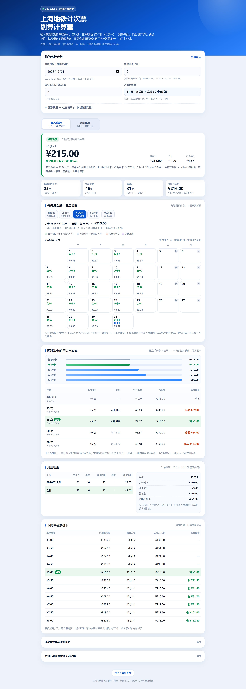
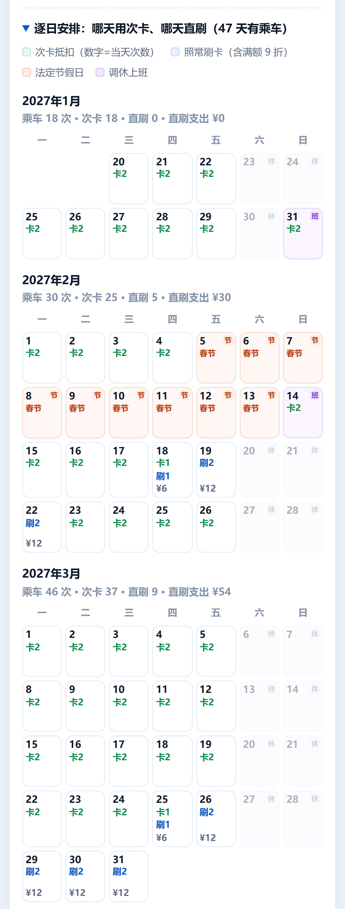

# 上海地铁计次票划算计算器

一个 **99 KB 的单文件网页**：双击就能打开，手机浏览器也能用，不用安装、不用联网、不上传任何数据。

输入激活日期、单程票价、每个工作日坐几次车，它会算清 31 天有效期内买哪种次卡最划算，并把每一次乘车逐日标在日历上——哪天用卡、哪天直刷、当天折合多少钱。

- **单次激活**：35 / 45 / 60 / 90 次四种卡逐一对比，告诉你买哪张、用掉几次、剩几次作废、折合单价多少，以及票价涨到多少才保本；
- **错峰排期**：给一段日期（最长一年），自动决定买几张、买哪几种、各在哪天激活，逐日排出安排，并对比「全程直刷」「第一天就激活」；
- **长期口径**：你只关心到某个截止日也没关系，它会额外提示一句「如果之后还接着坐，这套方案还能省多少」。

节假日与调休已内置 2025–2027（2028 之后可手填）；票价按 2026-12-01 起执行的口径，同一渠道自然月累计满 90 元后 9 折。





> 在线预览（GitHub Pages 开启后）：<https://youmenputao666.github.io/shanghai-metro-ticket-calculator/>
> 仓库里点开 html 文件只能看源码，想直接看到页面效果请用上面的地址，或把文件下载下来双击打开。

---

> 以下是「交接说明」，写给接手的 AI / 开发者：把工具的用途、口径、算法、代码结构、测试与已知边界一次说清。

---

## 1. 这是什么

输入**激活日期**、**单程票价**、**每工作日乘车次数**，算出在 31 天有效期（激活当日 + 之后 30 个自然日）内：

- 有多少个工作日（自动叠加法定节假日与调休上班）、共乘几次车；
- 四种次卡（35 / 45 / 60 / 90 次，售价 190 / 210 / 270 / 390 元）各自「**买一张卡 + 剩余乘次照常刷卡**」的总花费、卡内能用掉几次、剩几次作废、折合单价；
- 与「全程直接刷卡（同一支付渠道自然月累计满 90 元后 9 折）」相比省多少 / 多花多少；
- 值不值得买、买哪张最划算、票价涨到多少才保本；
- 用日历逐日标出：这天用次卡还是刷卡、当天折算花了多少钱，并标出节假日 / 调休。

界面语言为中文，移动端优先，支持打印 / 存 PDF。

---

## 2. 交付物清单

```
上海地铁计次票划算计算器.html   ← 工具本体（唯一必需文件）
README.md              ← 本文档
全部内容-AI单文件版.md          ← 说明 + 源码 + 标准答案（一份纯文本，可直接投喂给 AI）
测试/test.mjs                   ← 核心算法断言（Node，无需依赖）
测试/interact.mjs               ← 浏览器交互检查（CDP 驱动 Chrome）
测试/shot.mjs                   ← 截图工具（CDP）
tools/dump-scenarios.mjs        ← 导出典型场景的 JSON 结算结果
tools/capture-calendar.mjs      ← 指定日期/方案，只截日历卡片
tools/build-ai-bundle.mjs       ← 重新生成「全部内容-AI单文件版.md」
示例输出/scenarios.json         ← 上述脚本的产出（可直接对照数值）
截图/*.jpg                      ← 移动端 / 桌面 / 打印 / 日历局部效果
index.html                      ← 只有部署到 GitHub Pages 时才用：0 秒跳转到上面那个中文文件名
```

---

## 3. 计算口径（重要）

### 3.1 票价（2026-12-01 起执行）

| 里程 | 票价 |
|---|---|
| 0–4 km | 3 元 |
| 4–8 km | 4 元 |
| 8–12 km | 5 元 |
| 12–16 km | 6 元 |
| 16–23 km | 7 元 |
| 23–30 km | 8 元 |
| 30–40 km | 9 元 |
| 40–50 km | 10 元 |
| >50 km | 每 15 km 加 1 元 |

工具不按里程算，而是让用户直接输入「单程票价」（3–10 元，步长 0.1）。

### 3.2 计次票

| 次数 | 售价 | 单次标价 |
|---|---|---|
| 35 次 | 190 元 | 5.43 元 |
| 45 次 | 210 元 | 4.67 元 |
| 60 次 | 270 元 | 4.50 元 |
| 90 次 | 390 元 | 4.33 元 |

规则要点：仅限城轨线（不含磁浮线、金山铁路、市域机场线及以后开通的市域线）；实名、不可转让；**不与满额优惠同享**（所以次卡乘次既不计入 90 元累计，也不享受 9 折）；每自然年最多退票 3 次。

### 3.3 满额优惠

同一支付渠道，一个自然月内累计满 90 元后，该月后续乘次 9 折，次月重新累计。工具按「单笔累计」逐笔模拟：**折扣判定发生在扣款前**（`cum >= threshold` 时本笔打 9 折）。

### 3.4 有效期口径

`VALIDITY_DAYS = 31`：激活当天算第 1 天，含之后 30 个自然日，例如 12-01 激活 → 12-31 到期。这是官方口径（「自激活日及之后 30 个自然日」）。

> 历史版本曾按使用者要求固定为 30 天并取消 31 天选项；现按「以官方口径为准」改回 **31 天**。测试里仍保留 30 天对照组断言（E 段），改口径时两处要一起动。

### 3.5 节假日与调休

内置 2025 / 2026 / 2027 三年国务院安排：**90 个节假日 + 16 个调休上班日**（`DEFAULT_HOLIDAY_RANGES`、`DEFAULT_MAKEUP_DAYS`）。

- 调休：即使落在周六/周日也算工作日（如 2026-02-14、2026-02-28、2026-09-20、2026-10-10）。
- 判定优先级：先看调休表 → 再看节假日表 → 否则按周一至周五。
- 2028 年及以后无数据：页面会提示「未识别 X 年」，可在「节假日与调休数据」文本框里按 `2028-01-01~2028-01-03 元旦` / `2028-02-04 班` 的格式自行补。

---

## 4. 算法

核心代码在 `上海地铁计次票划算计算器.html` 的 `/* CORE_START */ … /* CORE_END */` 之间，是一段**不依赖 DOM** 的纯函数，可被 Node 直接抽取测试。

| 函数 | 作用 | 关键返回 |
|---|---|---|
| `defaultCalendarText()` | 内置节假日数据转成可编辑文本 | string |
| `parseCalendar(text)` | 解析文本 → 节假日/调休集合 | `{holidays, makeup, names, years, errors}` |
| `isWorkday(date, cal)` | 单日是否工作日（调休优先） | boolean |
| `buildRides({start, validityDays, fare, perWorkday, perOffDay, cal})` | 展开有效期内每天 | `{days, rides}`，`rides: [{date:'YYYY-MM-DD', month:'YYYY-MM', fare}]` |
| `ptCost(rides, threshold=90, rate=0.9)` | 纯刷卡成本（按自然月逐笔累计） | `{total, months:[{key, rides, cost, discounted}], ...}` |
| `evaluatePlan(counts, rides, opts)` | 买哪些卡（`counts` 对应 CARD_TYPES）的总成本 | `{counts, cards, cardCount, cardPrice, used, leftover, remaining, pt, total, unit, avgUnit, label}` |
| `planSchedule(plan, rides, opts)` | 把方案拆到「天」 | `Map<iso, {iso, card, paid, cost, discounted}>` |
| `cardPlans(rides, opts)` | 四张卡各买一张的方案，附 `savings` | 数组，按 `total` 升序 |
| `analyze(input)` | 总入口 | `{days, rides, base, cards, best, workdays, makeupDays, rideCount, start, validityDays, fare}` |
| `breakEvenFare(form, 3, 10, 0.1)` | 保本票价 | number 或 `null` |
| `scheduleSim({fromISO, toISO, fare, perWorkday, perOffDay, cal, threshold, rate, validityDays, cards})` | 逐日模拟「区间内若干张卡（各自激活日）+ 其余直刷」 | `{days, months, cash, cardCost, total, cashRides, cardRides, leftover, cards}`；`days[i] = {iso, month, work, count, card, cash, cost, use}`（`use = [[卡下标, 当天用了几次], …]`），`cards[j] = {k, i, count, price, start, end, used, left}` |
| `schedulePlans({...同上})` | 错峰排期：枚举每个工作日作为激活日，张数按区间长短自动放宽（366 天最多 24 张），给出最省方案 | `{base, best, bestOne, bestTwo, bestThree, bestCount, immediate, plans, workdays, fromISO, toISO}` |

推导要点：

1. **卡内次数优先抵扣最早发生的乘次**（`rides.slice(0, used)`），剩余乘次才走刷卡。这是乐观口径，也是官方「先扣卡」的直觉。
2. `total = cardPrice + ptCost(剩余乘次).total`；`unit = cardPrice / used`（分母是**实际用掉的次数**，所以卡用不完时单价会变高）；`leftover` 的卡内次数按整卡计入成本（作废即白付 `leftover × cardPrice/cardCount`）。
3. `best = cards[0]`，即**最便宜的单卡方案，可能比纯刷卡还贵**——此时结论卡显示「不建议购买」，并给出保本票价。
4. `breakEvenFare` 从 3 元起每 0.1 元试算，返回第一个 `savings > 0.005` 的票价（默认场景约 **5.10 元**）。
5. 「四种次卡」页签只考虑「**一张次卡 + 剩余直刷**」；多张卡叠加放在「错峰排期」里单独算（见 4.6）。

### 4.6 错峰排期（先直刷、晚点激活）

次卡是「激活后 31 天」有效，节假日（春节/国庆）落在窗口里会白白消耗卡内次数。所以可以先直刷、等假期过完再激活，用同样的 31 天覆盖更多工作日。

实现：

- `scheduleSim` 按天推进：每天先看有没有「已激活且未过期、还有余额」的卡，有就优先扣卡；没有就走直刷，并按自然月累计满 `threshold` 后打 `rate` 折。多张卡同时有效时用「先到期的先用」。逐日乘车量（星期/节假日/每天几次）先算好并缓存在 `WeakMap<cal, Map<区间+次数, days>>` 里，成百上千次模拟复用，一年区间约 0.6 秒。
- `schedulePlans` 自动决定张数：先把区间内每个**工作日**当候选激活日算 1 张卡的全部方案；再取每种卡「最省的前 5 个起始日 + 区间首日」两两组合；再用前 8 组两卡方案叠第三张卡；最后从当前最优解继续「一张一张地加」——注意是**在任意候选日插入**，不限于往后加（只往后加会漏掉「区间开头那几天其实也该开卡」的情况，比如 12/1 起就该买一张）；候选起始日 = 前面这些最优起点 ∪ 每月第一个工作日 ∪ 长假后第一个工作日，直到再加一张也省不下 0.5 元为止。插卡候选日有两套：一套是固定候选（见上），另一套额外包含「当前方案里每段纯直刷的第一天」（假期后那段空窗从哪天开卡，往往不在「每月第一个工作日」里）；两套各跑一遍贪心、取更省的，再从赢家补跑一轮——单跑一套会掉进不同的局部最优。张数上限按区间长度放宽：`maxCardsAuto = max(3, min(24, ceil(区间天数 / 30) + 2))`，366 天最多 24 张（一张卡 31 天窗口，实际用不满 24 张）。
- 「接力」候选（v5 新增）：以每个候选起始日为重启点，保留它之前已用完的卡，从该日开卡并在**每张卡用完的第二天**续下一张，一路排到区间末尾。这条路径专门覆盖「2/14 的卡用完，3/17 立刻接着买」这种不留空窗的排法——之前只贪心往后加卡，会漏掉它。
- 张数取舍：总花费更低才加卡；差价 ≤ 3 元时优先选张数少的（少折腾）。
- 买卡反而更贵时，结论条与下面的明细整体切换到「全程直刷」（`rec = good ? best : base`）：`best` 只从有卡方案里挑，永不回落到 `base`，所以直接用 `best` 会出现「标题写着买 1 张、下面又写建议直刷」的自相矛盾。注意 `base` 没有 `plan` 字段，判断要写成 `rec.plan && rec.plan.length`。
- 返回里的 `immediate` 是「第一天就激活」的最佳单卡，用于和错峰方案对比；`bestCount` 是建议张数。
- 已知取舍：组合部分是启发式（两卡穷举被剪枝、三卡只在前 8 组两卡方案上加），理论上可能漏掉极少数更优组合；常用场景（1–2 张、接力式多卡）都是精确解。

日历之外，页面新增「错峰排期」卡片：`#schFrom` / `#schTo`（默认激活日 ~ +179 天，即半年；上限 366 天），不再让用户选张数——买几张由算法决定并写在结论里。改动区间后只重算这张卡片（不整页刷新）。卡片内依次是：

1. **结论条**：建议买几张、每种卡几张、各张哪天激活、总花费，以及和「全直刷 / 第一天就激活」的对比；
2. **金额等式**：直刷几次多少钱 ＋ 次卡多少钱 ＝ 总花费；
3. **次卡明细表**：顶部「共 N 张次卡」+ 卡费汇总条；表体一张卡一行，列出 次卡（第 N 张 ＋ 45 次卡）/ 激活日 / 用到（有效期末日，附「31 天有效」）/ 用掉-剩（如「44 / 1 剩 1 次作废」；若这张卡的有效期跨过用户选的截止日，则写「剩 N 次，截止日后继续用」）/ 次卡支出 / 期间直刷 / 小计，末行合计；表格下方一句话拆解「次卡 ＋ 卡有效期内直刷 ＋ 卡外直刷（几次）＝ 总计」，把卡与卡之间空窗期的直刷单独说明；
4. **空窗说明**（`whyNote`）：逐段列出「两张卡之间那些只走直刷的日期」，把这段的乘车次数、直刷花了多少钱、以及「买一张装得下这么多乘次的最小卡要多少钱、会剩几次作废」摆在一起比，直接回答「这段为什么不开卡」。按天算而不是按月算——春节这种跨月空窗只有按天说才说得清；
5. **长期口径**（`horizonBlock`）：用户选的截止日只是「看到哪天为止」，不是「之后不坐车」。所以另按「截止日 ＋ 一张卡的有效期」再算一版计划：如果那版更省，就在这里写一句「继续坐的话，现在这套到 X 月 X 日还要再花 ¥A（直刷 ¥B）；把这段时间一起排，总共 ¥C，长期口径能省 ¥D」。主金额始终只算到用户选的截止日，两个数都摆出来，不替用户决定；
6. **候选方案表**：候选方案 / 激活日 / 总花费 / 较全直刷，当前采用的一行高亮；
7. **逐日安排**：按月给出小日历，**默认展开**（不再有 62 天阈值）。格子内直接写「45×2」——前面的数字是这张卡的次数规格，后面的数字是当天用掉几次；不同卡用浅底色块区分（`CARD_COLORS` 12 色，按第几张卡循环），多于一张卡时上方有「第N张 45次卡 3/2~4/1」色块图例；没有卡的日子写「刷N」和当天直刷支出（蓝色），节假日 / 调休照常上色。

（原「月度表：月份 / 工作日 / 乘车 / 次卡 / 直刷 / 直刷支出」已按用户要求从排期卡片里撤掉，数据仍在 `rec.months` 里，需要时加回去即可。）

---

## 5. 页面结构

单文件，`<style>` + `<body>` + 一段 `<script>`（IIFE）。CORE 段在前，页面代码在后。

- **视图切换（两个 tab）**：`#viewTabs` 里两个 `.view-tab`（`data-view="single"` / `"range"`）；`#viewSingle` 放单次激活的全部内容，`#viewRange` 放排期卡片（`hidden` 切换）。`setView(next, silent)` 负责切显隐、切 `is-active`/`aria-selected`，并在切到排期且结果未算时用 `lastRes/lastForm` 补渲——单次 tab 下完全不跑排期搜索（省几百毫秒）。状态 `view` 存进 localStorage；打印时 tab 栏隐藏，按当前 tab 的内容出纸。
- **表单**：`#activationDate`、`#fare`、`#perWorkday`、`#perOff`（在「更多设置」里，默认 0）、`#threshold`（默认 90）、`#rate`（默认 0.9）、`#calText`（可编辑节假日）、`#calReset`、`#calStatus`；排期卡片另有 `#schFrom`、`#schTo`（不再有张数下拉，张数由算法决定）。
- **渲染容器**：`#warnings`、`#viewTabs`、`#viewSingle`（`#printMeta`、`#verdict`、`#stats`、`#dayCalendar`、`#plans`、`#monthly`、`#fareTable`）、`#viewRange`（`#schCard` 内含 `#scheduleBody`）、`#calendarCard`。
- **渲染函数**：`render()`（总调度）→ `renderVerdict / renderStats / renderDayCalendar / renderSchedule / renderPlans / renderMonthly / renderFareTable`，末尾 `syncScrollTips()`。
- **方案切换**：`pickedKey` 取 `'base'` 或 `'c0'…'c3'`；`planChoices()` 生成 5 个按钮（`base` + 四张卡），`chosenChoice()` 决定当前展示的方案（默认：最省的单卡更便宜时用它，否则纯刷卡）。点击 `.plan-tab` 只重渲日历与月度明细，不整页刷新（避免输入焦点丢失）。
- **持久化**：`localStorage['shmetro-pass-calc/v1']`，字段 `date / fare / perWorkday / perOff / threshold / rate / schFrom / schTo / calText`；有效期不存（固定 31 天）。
- **打印**：`@media print` 隐藏表单、「更多设置」、按钮、文本域、方案标签、排期表单与提示，显示 `#printMeta`（参数摘要），保留结论、日历、排期结论、表格。
- **响应式**：≤560 宽时表格改为「隐藏次要列 + 横向滑动提示」；日历在 390 / 320 宽仍为 7 列。

---

## 6. 验证方式与期望值

```bash
node 测试/test.mjs        # 核心算法断言，期望输出 ALL TESTS PASSED
node 测试/interact.mjs    # 需要本机 Chrome；期望输出 ALL UI CHECKS PASSED（20 项）
node 测试/shot.mjs "file:///路径/上海地铁计次票划算计算器.html" 390 844 out.png   # 截图（CDP）
node tools/dump-scenarios.mjs > 示例输出/scenarios.json        # 导出对照数据
```

> 三个脚本都会自动在「上一级目录」找 `上海地铁计次票划算计算器.html`（找不到再退回同级目录的 `index.html`），所以整个文件夹随手挪动位置也不用改路径；Chrome 路径可用环境变量 `CHROME_PATH` 覆盖。

`test.mjs` 会从 HTML 里切出 CORE 段，用 `new Function` 取回 API，因此**改完核心代码不需要另建模块**。

### 31 天口径的标准答案

| 场景 | 工作日 | 乘车 | 纯刷卡 | 45 次卡 | 35 次卡 | 保本票价 |
|---|---|---|---|---|---|---|
| 2026-12-01，¥5，2 次/工作日（默认） | 23 | 46 | ¥216.00 | ¥215.00（省 1.00，剩 0） | ¥245.00 | ¥5.00 |
| 2026-12-15，¥5 | 22 | 44 | ¥216.00 | ¥210.00（省 6.00，剩 1） | ¥235.00 | — |
| 2026-02-10，¥5（跨春节） | 19 | 38 | ¥189.00 | ¥210.00 | ¥205.00 | — |
| 2027-01-20，¥6（含 2/5–2/13 春节） | 19 | 38 | ¥223.20 | ¥210.00 | ¥208.00（省 15.20，剩 0） | — |

60 次卡与 90 次卡在上述场景均更贵（默认场景分别剩 14 / 44 次）。作为对照，**30 天口径**下 2026-12-01 场景是 22 个工作日、44 次：纯刷卡 ¥207.00、45 次卡 ¥210.00（多 3 元）、保本 ¥5.10——口径变化会直接翻转「买不买」的结论，改口径时务必同步改测试。

### 错峰排期的标准答案

| 区间 | 票价 | 全直刷 | 最佳单卡 | 最佳排期（自动定张数） |
|---|---|---|---|---|
| 2026-12-01 ~ 2027-02-28 | ¥5 | ¥558.00 | ¥556.50（1/04 激活） | ¥555.50（45×2，12/01 + 1/04） |
| 2027-01-20 ~ 2027-03-31 | ¥6 | ¥534.60 | ¥493.20（45 次卡 3/01 激活） | ¥484.00（2 张：35 次卡 1/20 + 45 次卡 2/23） |
| 2026-09-20 ~ 2026-12-31 | ¥6 | ¥792.00 | ¥750.00（45 次卡 10/08 激活） | ¥700.00（3 张：35 次卡 9/20 + 45 次卡 10/28 + 45 次卡 12/01） |
| 2026-12-01 ~ 2027-05-29（默认半年） | ¥5 | ¥1143.00 | ¥1141.50（1/04 激活） | ¥1139.50（45×3，12/01 + 1/04 + 3/01） |
| 2026-03-01 ~ 2027-02-28（一年） | ¥6 | ¥2775.60 | ¥2733.60（3/02 激活） | ¥2429.80（11 张：45×10 + 35×1，3/02、4/01、5/06、6/01、7/01、8/03、9/01、10/08、11/08、12/09、次年 1/09） |

春节那行的对照最能说明问题：1/20 就激活 45 次卡要 ¥527.40（窗口里只有 19 个工作日，浪费 7 次），等到 3/01 激活只要 ¥493.20，省 **¥34.20**。

`interact.mjs` 覆盖：默认渲染、改日期后工作日数变化、票价修改后重算、localStorage 读写、节假日文本非法提示与恢复、日历格子数与工作日/刷卡标记、方案标签切换后日历与月度明细同步、排期卡片默认渲染、把区间改成 2027-01-20~2027-03-31 且票价 6 后应给出 ¥484.00 的两卡方案与「省 ¥50.60」、候选表包含多种卡种组合、自动决定张数（建议买 2 张）、逐日安排日历存在且含卡/刷标记、一年区间自动买到 11 张并渲染 12 个月、打印样式存在、空票价报错、恢复默认、无横向溢出、无运行期 JS 异常（共 28 项）。

---

## 7. 已知边界

- 只内置 2025–2027 节假日；2028+ 需手填。
- 单一支付渠道；不区分里程、换乘、早晚高峰；不计算公交换乘优惠；市域线（机场线等）不适用次卡，工具按「全部城轨」处理。
- 只支持「一张次卡 + 直刷」的四卡对比；多张卡只在「错峰排期」里自动计算（1–24 张，启发式剪枝 + 插入式贪心），理论上可能漏掉极少数更优组合。
- 排期区间最长一年（366 天），超出会自动截断；区间外不再计算，卡的有效期也不会延伸到区间之外。
- 金额按「分」四舍五入显示，逐日成本相加可能与月度合计有 ±0.05 的显示误差（合计以方案总额为准）。
- 无后端、无网络请求；参数只存在浏览器本地。

## 8. 可扩展方向

1. 恢复「30 / 31 天」可选口径（把 `VALIDITY_DAYS` 换成表单值，测试已保留 31 天对照组）。
2. 增加新卡种：改 `CARD_TYPES`，同时把 `[0,0,0,0]` 这类按 4 张卡写死的数组改为 `CARD_TYPES.map(() => 0)`，并让 `c0…c3` 的 key 生成逻辑跟着 `CARD_TYPES` 长度走。
3. 导出 CSV / 图片、按里程分档输入票价、多支付渠道分别累计。
4. 把 `planSchedule` 的结果做成 iCal 或可分享的月度卡片。
---

## 9. 授权与免责

本项目采用 [PolyForm Noncommercial License 1.0.0](LICENSE)：可以自由使用、修改、分享，**不能用于商业用途**。因为限制商用，它不属于 OSI 认定的开源协议，属于 source-available。

- 版权：Copyright 2026 youmenputao666 (https://github.com/youmenputao666)。协议要求分发时把 LICENSE 里那行 `Required Notice` 一并保留。
- 按现状提供，不保证持续更新、不保证修 BUG，使用风险自负。
- 票价、次卡规则、节假日与调休来自公开信息（上海地铁官网公告、国务院办公厅节假日安排），可能滞后或有误；买卡前请以官方渠道为准，本项目不对据此产生的购票决策负责。