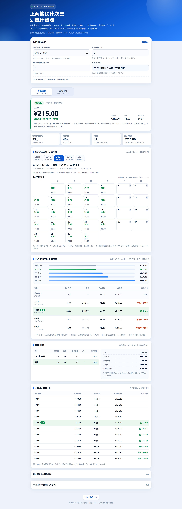
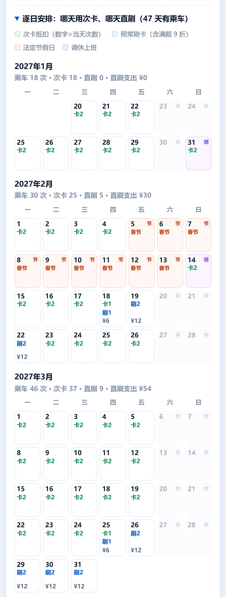

# 上海地铁计次票划算计算器 · AI 交接单文件版

> 这份纯文本把「交接说明 + 工具源码 + 标准答案」放在一起，便于直接交给另一个 AI 完整理解这个工具。
> 同目录下的 `上海地铁计次票划算计算器.html` 就是可直接运行的工具本体，本文件附录 A 中的源码与它逐字一致。
> 源码 SHA-256：`57983BACCFDE04A74C0F4BAE55E3429AFA642CA1C0A86163CA931A81DE7874C2`

## 目录

1. 交接说明（用途 / 口径 / 算法 / 结构 / 测试 / 边界）
2. 附录 A：完整 HTML 源码（单文件、离线、无外部依赖）
3. 附录 B：标准场景结算 JSON（可直接对照数字）
4. 附录 C：截图清单与复验命令

## 1. 交接说明

## 上海地铁计次票划算计算器

一个 **99 KB 的单文件网页**：双击就能打开，手机浏览器也能用，不用安装、不用联网、不上传任何数据。

#### 👉 在线直接用：<https://youmenputao666.github.io/shanghai-metro-ticket-calculator/>

（手机扫二维码/直接点这个链接就行；也可以把仓库里的 `上海地铁计次票划算计算器.html` 下载下来双击打开，效果完全一样。）

输入激活日期、单程票价、每个工作日坐几次车，它会算清 31 天有效期内买哪种次卡最划算，并把每一次乘车逐日标在日历上——哪天用卡、哪天直刷、当天折合多少钱。

- **单次激活**：35 / 45 / 60 / 90 次四种卡逐一对比，告诉你买哪张、用掉几次、剩几次作废、折合单价多少，以及票价涨到多少才保本；
- **错峰排期**：给一段日期（最长一年），自动决定买几张、买哪几种、各在哪天激活，逐日排出安排，并对比「全程直刷」「第一天就激活」；
- **长期口径**：你只关心到某个截止日也没关系，它会额外提示一句「如果之后还接着坐，这套方案还能省多少」。

节假日与调休已内置 2025–2027（2028 之后可手填）；票价按 2026-12-01 起执行的口径，同一渠道自然月累计满 90 元后 9 折。





---

> 以下是「交接说明」，写给接手的 AI / 开发者：把工具的用途、口径、算法、代码结构、测试与已知边界一次说清。

---

### 1. 这是什么

输入**激活日期**、**单程票价**、**每工作日乘车次数**，算出在 31 天有效期（激活当日 + 之后 30 个自然日）内：

- 有多少个工作日（自动叠加法定节假日与调休上班）、共乘几次车；
- 四种次卡（35 / 45 / 60 / 90 次，售价 190 / 210 / 270 / 390 元）各自「**买一张卡 + 剩余乘次照常刷卡**」的总花费、卡内能用掉几次、剩几次作废、折合单价；
- 与「全程直接刷卡（同一支付渠道自然月累计满 90 元后 9 折）」相比省多少 / 多花多少；
- 值不值得买、买哪张最划算、票价涨到多少才保本；
- 用日历逐日标出：这天用次卡还是刷卡、当天折算花了多少钱，并标出节假日 / 调休。

界面语言为中文，移动端优先，支持打印 / 存 PDF。

---

### 2. 交付物清单

```
上海地铁计次票划算计算器.html   ← 工具本体（唯一必需文件）
README.md              ← 本文档
全部内容-AI单文件版.md          ← 说明 + 源码 + 标准答案（一份纯文本，可直接投喂给 AI）
测试/test.mjs                   ← 核心算法断言（Node，无需依赖）
测试/interact.mjs               ← 浏览器交互检查（CDP 驱动 Chrome）
测试/shot.mjs                   ← 截图工具（CDP）
tools/dump-scenarios.mjs        ← 导出典型场景的 JSON 结算结果
tools/capture-calendar.mjs      ← 指定日期/方案，只截日历卡片
tools/build-ai-bundle.mjs       ← 重新生成「全部内容-AI单文件版.md」
示例输出/scenarios.json         ← 上述脚本的产出（可直接对照数值）
截图/*.jpg                      ← 移动端 / 桌面 / 打印 / 日历局部效果
index.html                      ← 只有部署到 GitHub Pages 时才用：0 秒跳转到上面那个中文文件名
```

---

### 3. 计算口径（重要）

#### 3.1 票价（2026-12-01 起执行）

| 里程 | 票价 |
|---|---|
| 0–4 km | 3 元 |
| 4–8 km | 4 元 |
| 8–12 km | 5 元 |
| 12–16 km | 6 元 |
| 16–23 km | 7 元 |
| 23–30 km | 8 元 |
| 30–40 km | 9 元 |
| 40–50 km | 10 元 |
| >50 km | 每 15 km 加 1 元 |

工具不按里程算，而是让用户直接输入「单程票价」（3–10 元，步长 0.1）。

#### 3.2 计次票

| 次数 | 售价 | 单次标价 |
|---|---|---|
| 35 次 | 190 元 | 5.43 元 |
| 45 次 | 210 元 | 4.67 元 |
| 60 次 | 270 元 | 4.50 元 |
| 90 次 | 390 元 | 4.33 元 |

规则要点：仅限城轨线（不含磁浮线、金山铁路、市域机场线及以后开通的市域线）；实名、不可转让；**不与满额优惠同享**（所以次卡乘次既不计入 90 元累计，也不享受 9 折）；每自然年最多退票 3 次。

#### 3.3 满额优惠

同一支付渠道，一个自然月内累计满 90 元后，该月后续乘次 9 折，次月重新累计。工具按「单笔累计」逐笔模拟：**折扣判定发生在扣款前**（`cum >= threshold` 时本笔打 9 折）。

#### 3.4 有效期口径

`VALIDITY_DAYS = 31`：激活当天算第 1 天，含之后 30 个自然日，例如 12-01 激活 → 12-31 到期。这是官方口径（「自激活日及之后 30 个自然日」）。

> 历史版本曾按使用者要求固定为 30 天并取消 31 天选项；现按「以官方口径为准」改回 **31 天**。测试里仍保留 30 天对照组断言（E 段），改口径时两处要一起动。

#### 3.5 节假日与调休

内置 2025 / 2026 / 2027 三年国务院安排：**90 个节假日 + 16 个调休上班日**（`DEFAULT_HOLIDAY_RANGES`、`DEFAULT_MAKEUP_DAYS`）。

- 调休：即使落在周六/周日也算工作日（如 2026-02-14、2026-02-28、2026-09-20、2026-10-10）。
- 判定优先级：先看调休表 → 再看节假日表 → 否则按周一至周五。
- 2028 年及以后无数据：页面会提示「未识别 X 年」，可在「节假日与调休数据」文本框里按 `2028-01-01~2028-01-03 元旦` / `2028-02-04 班` 的格式自行补。

---

### 4. 算法

核心代码在 `上海地铁计次票划算计算器.html` 的 `/* CORE_START */ … /* CORE_END */` 之间，是一段**不依赖 DOM** 的纯函数，可被 Node 直接抽取测试。

| 函数 | 作用 | 关键返回 |
|---|---|---|
| `defaultCalendarText()` | 内置节假日数据转成可编辑文本 | string |
| `parseCalendar(text)` | 解析文本 → 节假日/调休集合 | `{holidays, makeup, names, years, errors}` |
| `isWorkday(date, cal)` | 单日是否工作日（调休优先） | boolean |
| `buildRides({start, validityDays, fare, perWorkday, perOffDay, cal})` | 展开有效期内每天 | `{days, rides}`，`rides: [{date:'YYYY-MM-DD', month:'YYYY-MM', fare}]` |
| `ptCost(rides, threshold=90, rate=0.9)` | 纯刷卡成本（按自然月逐笔累计） | `{total, months:[{key, rides, cost, discounted}], ...}` |
| `evaluatePlan(counts, rides, opts)` | 买哪些卡（`counts` 对应 CARD_TYPES）的总成本 | `{counts, cards, cardCount, cardPrice, used, leftover, remaining, pt, total, unit, avgUnit, label}` |
| `planSchedule(plan, rides, opts)` | 把方案拆到「天」 | `Map<iso, {iso, card, paid, cost, discounted}>` |
| `cardPlans(rides, opts)` | 四张卡各买一张的方案，附 `savings` | 数组，按 `total` 升序 |
| `analyze(input)` | 总入口 | `{days, rides, base, cards, best, workdays, makeupDays, rideCount, start, validityDays, fare}` |
| `breakEvenFare(form, 3, 10, 0.1)` | 保本票价 | number 或 `null` |
| `scheduleSim({fromISO, toISO, fare, perWorkday, perOffDay, cal, threshold, rate, validityDays, cards})` | 逐日模拟「区间内若干张卡（各自激活日）+ 其余直刷」 | `{days, months, cash, cardCost, total, cashRides, cardRides, leftover, cards}`；`days[i] = {iso, month, work, count, card, cash, cost, use}`（`use = [[卡下标, 当天用了几次], …]`），`cards[j] = {k, i, count, price, start, end, used, left}` |
| `schedulePlans({...同上})` | 错峰排期：枚举每个工作日作为激活日，张数按区间长短自动放宽（366 天最多 24 张），给出最省方案 | `{base, best, bestOne, bestTwo, bestThree, bestCount, immediate, plans, workdays, fromISO, toISO}` |

推导要点：

1. **卡内次数优先抵扣最早发生的乘次**（`rides.slice(0, used)`），剩余乘次才走刷卡。这是乐观口径，也是官方「先扣卡」的直觉。
2. `total = cardPrice + ptCost(剩余乘次).total`；`unit = cardPrice / used`（分母是**实际用掉的次数**，所以卡用不完时单价会变高）；`leftover` 的卡内次数按整卡计入成本（作废即白付 `leftover × cardPrice/cardCount`）。
3. `best = cards[0]`，即**最便宜的单卡方案，可能比纯刷卡还贵**——此时结论卡显示「不建议购买」，并给出保本票价。
4. `breakEvenFare` 从 3 元起每 0.1 元试算，返回第一个 `savings > 0.005` 的票价（默认场景约 **5.10 元**）。
5. 「四种次卡」页签只考虑「**一张次卡 + 剩余直刷**」；多张卡叠加放在「错峰排期」里单独算（见 4.6）。

#### 4.6 错峰排期（先直刷、晚点激活）

次卡是「激活后 31 天」有效，节假日（春节/国庆）落在窗口里会白白消耗卡内次数。所以可以先直刷、等假期过完再激活，用同样的 31 天覆盖更多工作日。

实现：

- `scheduleSim` 按天推进：每天先看有没有「已激活且未过期、还有余额」的卡，有就优先扣卡；没有就走直刷，并按自然月累计满 `threshold` 后打 `rate` 折。多张卡同时有效时用「先到期的先用」。逐日乘车量（星期/节假日/每天几次）先算好并缓存在 `WeakMap<cal, Map<区间+次数, days>>` 里，成百上千次模拟复用，一年区间约 0.6 秒。
- `schedulePlans` 自动决定张数：先把区间内每个**工作日**当候选激活日算 1 张卡的全部方案；再取每种卡「最省的前 5 个起始日 + 区间首日」两两组合；再用前 8 组两卡方案叠第三张卡；最后从当前最优解继续「一张一张地加」——注意是**在任意候选日插入**，不限于往后加（只往后加会漏掉「区间开头那几天其实也该开卡」的情况，比如 12/1 起就该买一张）；候选起始日 = 前面这些最优起点 ∪ 每月第一个工作日 ∪ 长假后第一个工作日，直到再加一张也省不下 0.5 元为止。插卡候选日有两套：一套是固定候选（见上），另一套额外包含「当前方案里每段纯直刷的第一天」（假期后那段空窗从哪天开卡，往往不在「每月第一个工作日」里）；两套各跑一遍贪心、取更省的，再从赢家补跑一轮——单跑一套会掉进不同的局部最优。张数上限按区间长度放宽：`maxCardsAuto = max(3, min(24, ceil(区间天数 / 30) + 2))`，366 天最多 24 张（一张卡 31 天窗口，实际用不满 24 张）。
- 「接力」候选（v5 新增）：以每个候选起始日为重启点，保留它之前已用完的卡，从该日开卡并在**每张卡用完的第二天**续下一张，一路排到区间末尾。这条路径专门覆盖「2/14 的卡用完，3/17 立刻接着买」这种不留空窗的排法——之前只贪心往后加卡，会漏掉它。
- 张数取舍：总花费更低才加卡；差价 ≤ 3 元时优先选张数少的（少折腾）。
- 买卡反而更贵时，结论条与下面的明细整体切换到「全程直刷」（`rec = good ? best : base`）：`best` 只从有卡方案里挑，永不回落到 `base`，所以直接用 `best` 会出现「标题写着买 1 张、下面又写建议直刷」的自相矛盾。注意 `base` 没有 `plan` 字段，判断要写成 `rec.plan && rec.plan.length`。
- 返回里的 `immediate` 是「第一天就激活」的最佳单卡，用于和错峰方案对比；`bestCount` 是建议张数。
- 已知取舍：组合部分是启发式（两卡穷举被剪枝、三卡只在前 8 组两卡方案上加），理论上可能漏掉极少数更优组合；常用场景（1–2 张、接力式多卡）都是精确解。

日历之外，页面新增「错峰排期」卡片：`#schFrom` / `#schTo`（默认激活日 ~ +179 天，即半年；上限 366 天），不再让用户选张数——买几张由算法决定并写在结论里。改动区间后只重算这张卡片（不整页刷新）。卡片内依次是：

1. **结论条**：建议买几张、每种卡几张、各张哪天激活、总花费，以及和「全直刷 / 第一天就激活」的对比；
2. **金额等式**：直刷几次多少钱 ＋ 次卡多少钱 ＝ 总花费；
3. **次卡明细表**：顶部「共 N 张次卡」+ 卡费汇总条；表体一张卡一行，列出 次卡（第 N 张 ＋ 45 次卡）/ 激活日 / 用到（有效期末日，附「31 天有效」）/ 用掉-剩（如「44 / 1 剩 1 次作废」；若这张卡的有效期跨过用户选的截止日，则写「剩 N 次，截止日后继续用」）/ 次卡支出 / 期间直刷 / 小计，末行合计；表格下方一句话拆解「次卡 ＋ 卡有效期内直刷 ＋ 卡外直刷（几次）＝ 总计」，把卡与卡之间空窗期的直刷单独说明；
4. **空窗说明**（`whyNote`）：逐段列出「两张卡之间那些只走直刷的日期」，把这段的乘车次数、直刷花了多少钱、以及「买一张装得下这么多乘次的最小卡要多少钱、会剩几次作废」摆在一起比，直接回答「这段为什么不开卡」。按天算而不是按月算——春节这种跨月空窗只有按天说才说得清；
5. **长期口径**（`horizonBlock`）：用户选的截止日只是「看到哪天为止」，不是「之后不坐车」。所以另按「截止日 ＋ 一张卡的有效期」再算一版计划：如果那版更省，就在这里写一句「继续坐的话，现在这套到 X 月 X 日还要再花 ¥A（直刷 ¥B）；把这段时间一起排，总共 ¥C，长期口径能省 ¥D」。主金额始终只算到用户选的截止日，两个数都摆出来，不替用户决定；
6. **候选方案表**：候选方案 / 激活日 / 总花费 / 较全直刷，当前采用的一行高亮；
7. **逐日安排**：按月给出小日历，**默认展开**（不再有 62 天阈值）。格子内直接写「45×2」——前面的数字是这张卡的次数规格，后面的数字是当天用掉几次；不同卡用浅底色块区分（`CARD_COLORS` 12 色，按第几张卡循环），多于一张卡时上方有「第N张 45次卡 3/2~4/1」色块图例；没有卡的日子写「刷N」和当天直刷支出（蓝色），节假日 / 调休照常上色。

（原「月度表：月份 / 工作日 / 乘车 / 次卡 / 直刷 / 直刷支出」已按用户要求从排期卡片里撤掉，数据仍在 `rec.months` 里，需要时加回去即可。）

---

### 5. 页面结构

单文件，`<style>` + `<body>` + 一段 `<script>`（IIFE）。CORE 段在前，页面代码在后。

- **视图切换（两个 tab）**：`#viewTabs` 里两个 `.view-tab`（`data-view="single"` / `"range"`）；`#viewSingle` 放单次激活的全部内容，`#viewRange` 放排期卡片（`hidden` 切换）。`setView(next, silent)` 负责切显隐、切 `is-active`/`aria-selected`，并在切到排期且结果未算时用 `lastRes/lastForm` 补渲——单次 tab 下完全不跑排期搜索（省几百毫秒）。状态 `view` 存进 localStorage；打印时 tab 栏隐藏，按当前 tab 的内容出纸。
- **表单**：`#activationDate`、`#fare`、`#perWorkday`、`#perOff`（在「更多设置」里，默认 0）、`#threshold`（默认 90）、`#rate`（默认 0.9）、`#calText`（可编辑节假日）、`#calReset`、`#calStatus`；排期卡片另有 `#schFrom`、`#schTo`（不再有张数下拉，张数由算法决定）。
- **渲染容器**：`#warnings`、`#viewTabs`、`#viewSingle`（`#printMeta`、`#verdict`、`#stats`、`#dayCalendar`、`#plans`、`#monthly`、`#fareTable`）、`#viewRange`（`#schCard` 内含 `#scheduleBody`）、`#calendarCard`。
- **渲染函数**：`render()`（总调度）→ `renderVerdict / renderStats / renderDayCalendar / renderSchedule / renderPlans / renderMonthly / renderFareTable`，末尾 `syncScrollTips()`。
- **方案切换**：`pickedKey` 取 `'base'` 或 `'c0'…'c3'`；`planChoices()` 生成 5 个按钮（`base` + 四张卡），`chosenChoice()` 决定当前展示的方案（默认：最省的单卡更便宜时用它，否则纯刷卡）。点击 `.plan-tab` 只重渲日历与月度明细，不整页刷新（避免输入焦点丢失）。
- **持久化**：`localStorage['shmetro-pass-calc/v1']`，字段 `date / fare / perWorkday / perOff / threshold / rate / schFrom / schTo / calText`；有效期不存（固定 31 天）。
- **打印**：`@media print` 隐藏表单、「更多设置」、按钮、文本域、方案标签、排期表单与提示，显示 `#printMeta`（参数摘要），保留结论、日历、排期结论、表格。
- **响应式**：≤560 宽时表格改为「隐藏次要列 + 横向滑动提示」；日历在 390 / 320 宽仍为 7 列。

---

### 6. 验证方式与期望值

```bash
node 测试/test.mjs        # 核心算法断言，期望输出 ALL TESTS PASSED
node 测试/interact.mjs    # 需要本机 Chrome；期望输出 ALL UI CHECKS PASSED（20 项）
node 测试/shot.mjs "file:///路径/上海地铁计次票划算计算器.html" 390 844 out.png   # 截图（CDP）
node tools/dump-scenarios.mjs > 示例输出/scenarios.json        # 导出对照数据
```

> 三个脚本都会自动在「上一级目录」找 `上海地铁计次票划算计算器.html`（找不到再退回同级目录的 `index.html`），所以整个文件夹随手挪动位置也不用改路径；Chrome 路径可用环境变量 `CHROME_PATH` 覆盖。

`test.mjs` 会从 HTML 里切出 CORE 段，用 `new Function` 取回 API，因此**改完核心代码不需要另建模块**。

#### 31 天口径的标准答案

| 场景 | 工作日 | 乘车 | 纯刷卡 | 45 次卡 | 35 次卡 | 保本票价 |
|---|---|---|---|---|---|---|
| 2026-12-01，¥5，2 次/工作日（默认） | 23 | 46 | ¥216.00 | ¥215.00（省 1.00，剩 0） | ¥245.00 | ¥5.00 |
| 2026-12-15，¥5 | 22 | 44 | ¥216.00 | ¥210.00（省 6.00，剩 1） | ¥235.00 | — |
| 2026-02-10，¥5（跨春节） | 19 | 38 | ¥189.00 | ¥210.00 | ¥205.00 | — |
| 2027-01-20，¥6（含 2/5–2/13 春节） | 19 | 38 | ¥223.20 | ¥210.00 | ¥208.00（省 15.20，剩 0） | — |

60 次卡与 90 次卡在上述场景均更贵（默认场景分别剩 14 / 44 次）。作为对照，**30 天口径**下 2026-12-01 场景是 22 个工作日、44 次：纯刷卡 ¥207.00、45 次卡 ¥210.00（多 3 元）、保本 ¥5.10——口径变化会直接翻转「买不买」的结论，改口径时务必同步改测试。

#### 错峰排期的标准答案

| 区间 | 票价 | 全直刷 | 最佳单卡 | 最佳排期（自动定张数） |
|---|---|---|---|---|
| 2026-12-01 ~ 2027-02-28 | ¥5 | ¥558.00 | ¥556.50（1/04 激活） | ¥555.50（45×2，12/01 + 1/04） |
| 2027-01-20 ~ 2027-03-31 | ¥6 | ¥534.60 | ¥493.20（45 次卡 3/01 激活） | ¥484.00（2 张：35 次卡 1/20 + 45 次卡 2/23） |
| 2026-09-20 ~ 2026-12-31 | ¥6 | ¥792.00 | ¥750.00（45 次卡 10/08 激活） | ¥700.00（3 张：35 次卡 9/20 + 45 次卡 10/28 + 45 次卡 12/01） |
| 2026-12-01 ~ 2027-05-29（默认半年） | ¥5 | ¥1143.00 | ¥1141.50（1/04 激活） | ¥1139.50（45×3，12/01 + 1/04 + 3/01） |
| 2026-03-01 ~ 2027-02-28（一年） | ¥6 | ¥2775.60 | ¥2733.60（3/02 激活） | ¥2429.80（11 张：45×10 + 35×1，3/02、4/01、5/06、6/01、7/01、8/03、9/01、10/08、11/08、12/09、次年 1/09） |

春节那行的对照最能说明问题：1/20 就激活 45 次卡要 ¥527.40（窗口里只有 19 个工作日，浪费 7 次），等到 3/01 激活只要 ¥493.20，省 **¥34.20**。

`interact.mjs` 覆盖：默认渲染、改日期后工作日数变化、票价修改后重算、localStorage 读写、节假日文本非法提示与恢复、日历格子数与工作日/刷卡标记、方案标签切换后日历与月度明细同步、排期卡片默认渲染、把区间改成 2027-01-20~2027-03-31 且票价 6 后应给出 ¥484.00 的两卡方案与「省 ¥50.60」、候选表包含多种卡种组合、自动决定张数（建议买 2 张）、逐日安排日历存在且含卡/刷标记、一年区间自动买到 11 张并渲染 12 个月、打印样式存在、空票价报错、恢复默认、无横向溢出、无运行期 JS 异常（共 28 项）。

---

### 7. 已知边界

- 只内置 2025–2027 节假日；2028+ 需手填。
- 单一支付渠道；不区分里程、换乘、早晚高峰；不计算公交换乘优惠；市域线（机场线等）不适用次卡，工具按「全部城轨」处理。
- 只支持「一张次卡 + 直刷」的四卡对比；多张卡只在「错峰排期」里自动计算（1–24 张，启发式剪枝 + 插入式贪心），理论上可能漏掉极少数更优组合。
- 排期区间最长一年（366 天），超出会自动截断；区间外不再计算，卡的有效期也不会延伸到区间之外。
- 金额按「分」四舍五入显示，逐日成本相加可能与月度合计有 ±0.05 的显示误差（合计以方案总额为准）。
- 无后端、无网络请求；参数只存在浏览器本地。

### 8. 可扩展方向

1. 恢复「30 / 31 天」可选口径（把 `VALIDITY_DAYS` 换成表单值，测试已保留 31 天对照组）。
2. 增加新卡种：改 `CARD_TYPES`，同时把 `[0,0,0,0]` 这类按 4 张卡写死的数组改为 `CARD_TYPES.map(() => 0)`，并让 `c0…c3` 的 key 生成逻辑跟着 `CARD_TYPES` 长度走。
3. 导出 CSV / 图片、按里程分档输入票价、多支付渠道分别累计。
4. 把 `planSchedule` 的结果做成 iCal 或可分享的月度卡片。
---

### 9. 授权与免责

本项目采用 [PolyForm Noncommercial License 1.0.0](LICENSE)：可以自由使用、修改、分享，**不能用于商业用途**。因为限制商用，它不属于 OSI 认定的开源协议，属于 source-available。

- 版权：Copyright 2026 youmenputao666 (https://github.com/youmenputao666)。协议要求分发时把 LICENSE 里那行 `Required Notice` 一并保留。
- 按现状提供，不保证持续更新、不保证修 BUG，使用风险自负。
- 票价、次卡规则、节假日与调休来自公开信息（上海地铁官网公告、国务院办公厅节假日安排），可能滞后或有误；买卡前请以官方渠道为准，本项目不对据此产生的购票决策负责。

## 2. 附录 A：完整 HTML 源码

单文件 96.8 KB，包含 HTML、内联 CSS、内联 JS 与 2025–2027 节假日数据；核心算法在 `/* CORE_START */` 与 `/* CORE_END */` 之间。

```html
<!doctype html>
<html lang="zh-CN">
<head>
<meta charset="utf-8">
<meta name="viewport" content="width=device-width, initial-scale=1, viewport-fit=cover">
<meta name="theme-color" content="#0b57d0">
<title>上海地铁计次票 · 划算计算器</title>
<style>
  :root{
    --bg:#eef3fb; --card:#ffffff; --ink:#0e1b2e; --muted:#5c6c86; --muted2:#8494ac;
    --line:#e2eaf6; --blue:#0b57d0; --blue2:#2f86ff;
    --green:#0a8f4d; --green-bg:#eaf7ef;
    --red:#c9370b; --red-bg:#fdeee8;
    --amber:#9a6100;
    --radius:18px;
    --shadow:0 10px 30px rgba(15,50,110,.06);
  }
  *{box-sizing:border-box}
  html{-webkit-text-size-adjust:100%}
  body{
    margin:0;background:var(--bg);color:var(--ink);font-size:15px;line-height:1.6;
    font-family:-apple-system,BlinkMacSystemFont,"PingFang SC","Hiragino Sans GB","Microsoft YaHei",system-ui,sans-serif;
    font-variant-numeric:tabular-nums;
  }
  b,strong{font-weight:700}
  small{font-size:.72em;font-weight:600}
  .hero{
    position:relative;overflow:hidden;color:#fff;padding:30px 20px 48px;
    background:linear-gradient(150deg,#06296a 0%,#0b57d0 55%,#2f86ff 100%);
  }
  .hero::before{
    content:"";position:absolute;width:360px;height:360px;right:-110px;top:-150px;border-radius:50%;
    background:radial-gradient(circle at 35% 35%,rgba(255,255,255,.30),rgba(255,255,255,0) 65%);
  }
  .hero::after{
    content:"";position:absolute;width:260px;height:260px;left:-100px;bottom:-150px;border-radius:50%;
    background:radial-gradient(circle at 50% 50%,rgba(120,200,255,.35),rgba(120,200,255,0) 70%);
  }
  .hero-inner{position:relative;z-index:1;max-width:860px;margin:0 auto}
  .hero .pill{
    display:inline-flex;align-items:center;gap:6px;padding:5px 11px;border-radius:999px;
    background:rgba(255,255,255,.14);border:1px solid rgba(255,255,255,.26);
    font-size:12px;font-weight:600;letter-spacing:.04em;backdrop-filter:blur(4px);
  }
  .hero .pill i{width:6px;height:6px;border-radius:50%;background:#7dffb2;box-shadow:0 0 0 3px rgba(125,255,178,.25)}
  .hero h1{
    margin:14px 0 8px;font-size:clamp(25px,5.2vw,34px);line-height:1.25;letter-spacing:.5px;font-weight:800;
  }
  .hero p{margin:0;max-width:600px;color:rgba(255,255,255,.84);font-size:13.5px}
  .hero .src{margin-top:10px;color:rgba(255,255,255,.62);font-size:11.5px}

  main{max-width:880px;margin:-26px auto 40px;padding:0 14px;display:flex;flex-direction:column;gap:14px;position:relative;z-index:2}

  .view-tabs{display:flex;gap:5px;background:#e6ecf9;border:1px solid #dbe4f6;border-radius:14px;padding:4px}
  .view-tab{flex:1;min-width:0;display:flex;flex-direction:column;align-items:center;gap:1px;border:0;background:transparent;border-radius:10px;padding:8px;font-family:inherit;font-size:14px;font-weight:700;color:#42536e;cursor:pointer;transition:background .15s,color .15s}
  .view-tab em{font-style:normal;font-weight:500;font-size:11px;color:#6b7c96}
  .view-tab.is-active{background:#fff;color:#0b57d0;box-shadow:0 1px 4px rgba(15,23,42,.12)}
  .view-tab.is-active em{color:#4a6da8}
  .view-tab:focus-visible{outline:2px solid #0b57d0;outline-offset:1px}
  .view{display:flex;flex-direction:column;gap:14px}
  .view[hidden]{display:none}
  @media (min-width:721px){
    .view-tabs{align-self:flex-start}
    .view-tab{flex:0 0 auto;padding:8px 28px}
  }

  .card{
    background:var(--card);border:1px solid var(--line);border-radius:var(--radius);
    padding:18px 18px;box-shadow:var(--shadow);
  }
  .card.tight{padding:14px 16px}
  .sec-title{display:flex;align-items:center;gap:9px;margin:0 0 12px;font-size:15.5px;font-weight:800;letter-spacing:.01em}
  .sec-title::before{content:"";width:4px;height:15px;border-radius:2px;background:linear-gradient(180deg,#2f86ff,#0b57d0)}
  .sec-title .sub{font-size:12px;font-weight:500;color:var(--muted2);margin-left:auto}
  .hint{font-size:12px;color:var(--muted2);margin:10px 0 0;line-height:1.55}
  .hint code{background:#f1f5fd;border:1px solid #e3ebf8;border-radius:5px;padding:0 4px;font-size:11.5px}

  /* ---------- 表单 ---------- */
  .form-head{display:flex;align-items:center;justify-content:space-between;margin-bottom:14px}
  .form-head h2{margin:0;font-size:15.5px;font-weight:800}
  .link{border:0;background:none;color:var(--blue);font:inherit;font-size:12.5px;font-weight:600;cursor:pointer;padding:4px 2px}
  .link:hover{text-decoration:underline}
  .form-grid{display:grid;grid-template-columns:1fr 1fr;gap:12px}
  .field{display:flex;flex-direction:column;gap:5px;min-width:0}
  .field>label,.field>.field-label{font-size:12px;font-weight:700;color:var(--muted);letter-spacing:.02em}
  .field .field-hint{font-size:11px;color:var(--muted2)}
  input,select{
    width:100%;padding:10px 12px;border:1px solid #d7e2f3;border-radius:12px;font:inherit;
    background:#f9fbff;color:var(--ink);transition:border-color .15s,box-shadow .15s;
  }
  input:hover,select:hover{border-color:#bcd0ec}
  input:focus,select:focus{outline:none;border-color:var(--blue);box-shadow:0 0 0 3px rgba(11,87,208,.13);background:#fff}
  .more{margin-top:14px;border-top:1px dashed var(--line);padding-top:10px}
  .more summary{cursor:pointer;font-size:12.5px;font-weight:700;color:var(--muted);list-style:none;display:flex;align-items:center;gap:6px}
  .more summary::-webkit-details-marker{display:none}
  .more summary::before{content:"＋";font-size:12px;color:var(--blue);font-weight:800}
  .more[open] summary::before{content:"－"}
  .more .form-grid{margin-top:12px}

  /* ---------- 提示 ---------- */
  .warn{background:#fff8e6;border:1px solid #f5dfae;color:#7a4d00;border-radius:14px;padding:11px 14px;font-size:12.5px;line-height:1.6}
  .warn b{color:#7a4d00}
  .warn ul{margin:4px 0 0;padding-left:18px}
  .warn li{margin:2px 0}

  /* ---------- 结论 ---------- */
  .verdict{position:relative;overflow:hidden;border-left:5px solid var(--green);padding:20px 20px 18px}
  .verdict.bad{border-left-color:var(--red)}
  .verdict-head{display:flex;align-items:center;gap:10px;flex-wrap:wrap}
  .tag{display:inline-flex;align-items:center;padding:3px 10px;border-radius:999px;font-size:12px;font-weight:800;letter-spacing:.04em}
  .tag.good{background:var(--green-bg);color:var(--green)}
  .tag.bad{background:var(--red-bg);color:var(--red)}
  .tag.soft{background:#fff4e0;color:#b45309}
  .verdict-note{font-size:12px;color:var(--muted2)}
  .verdict-main{display:flex;align-items:flex-end;justify-content:space-between;gap:18px;margin-top:10px;flex-wrap:wrap}
  .plan-name{font-size:15px;font-weight:800;color:var(--muted)}
  .big-num{font-size:clamp(34px,8vw,44px);font-weight:850;line-height:1.1;letter-spacing:-.5px;margin:2px 0 4px}
  .delta{font-size:13px;font-weight:700}
  .delta.good{color:var(--green)}
  .delta.bad{color:var(--red)}
  .verdict-side{display:flex;gap:18px;flex-wrap:wrap}
  .verdict-side>div{display:flex;flex-direction:column;gap:1px;min-width:76px}
  .verdict-side span{font-size:11px;color:var(--muted2)}
  .verdict-side b{font-size:15px;font-weight:800}
  .verdict-desc{margin:12px 0 0;font-size:12.5px;color:var(--muted);line-height:1.7}

  /* ---------- 指标 ---------- */
  .stats{display:grid;grid-template-columns:repeat(4,1fr);gap:10px}
  .tile{background:#fff;border:1px solid var(--line);border-radius:14px;padding:12px 13px;box-shadow:var(--shadow)}
  .tile span{display:block;font-size:11px;color:var(--muted2);font-weight:600}
  .tile b{display:block;font-size:20px;font-weight:850;line-height:1.35;margin-top:1px}
  .tile b small{font-size:11px;font-weight:600;color:var(--muted);margin-left:2px}
  .tile em{display:block;font-style:normal;font-size:10.5px;color:var(--muted2);line-height:1.4;margin-top:2px}

  /* ---------- 表格 ---------- */
  .table-wrap{overflow-x:auto;-webkit-overflow-scrolling:touch;margin:0 -4px;padding:0 4px}
  .scroll-tip{display:none;margin:7px 0 0;font-size:11px;color:var(--muted2)}
  .scroll-tip[hidden]{display:none !important}
  .print-meta{display:none}
  table{border-collapse:collapse;width:100%;min-width:680px;font-size:13px}
  th{font-size:11px;color:var(--muted2);font-weight:700;text-align:right;padding:7px 9px;border-bottom:1px solid var(--line);white-space:nowrap;background:#fbfdff}
  th:first-child,td:first-child{text-align:left}
  td{padding:10px 9px;border-bottom:1px solid #eef3fa;text-align:right;white-space:nowrap;vertical-align:middle}
  tr:last-child td{border-bottom:0}
  tbody tr:hover td{background:#f8fbff}
  tr.best td{background:var(--green-bg)}
  tr.best:hover td{background:#e2f4ea}
  tr.base td{color:var(--muted);background:#fafcff}
  .pos{color:var(--green);font-weight:800}
  .neg{color:var(--red);font-weight:700}
  .muted{color:var(--muted2)}
  .badge{display:inline-block;margin-left:6px;padding:1px 7px;border-radius:999px;background:var(--green);color:#fff;font-size:10px;font-weight:700;vertical-align:1px}
  .badge.gray{background:#aab8cc}
  .plan-cell b{font-weight:800}
  .plan-cell span:not(.badge){display:block;font-size:10.5px;color:var(--muted2)}
  .plan-cell .badge{margin-left:6px;vertical-align:1px}

  /* ---------- 条形对比 ---------- */
  .bars{margin:2px 0 14px;padding:12px 13px;background:#f8fbff;border:1px solid #e8f0fb;border-radius:14px}
  .bar-row{display:grid;grid-template-columns:86px 1fr 76px;gap:10px;align-items:center;margin:7px 0;font-size:12px}
  .bar-row:first-child{margin-top:0}.bar-row:last-child{margin-bottom:0}
  .bar-row .lbl{color:var(--muted);font-weight:600;white-space:nowrap;overflow:hidden;text-overflow:ellipsis}
  .bar-row .val{text-align:right;font-weight:800;color:var(--ink)}
  .bar{height:9px;border-radius:6px;background:#e6eefb;overflow:hidden}
  .bar>i{display:block;height:100%;border-radius:6px;background:linear-gradient(90deg,#7db4ff,#2f86ff)}
  .bar-row.is-best .lbl{color:var(--green);font-weight:800}
  .bar-row.is-best .val{color:var(--green)}
  .bar-row.is-best .bar>i{background:linear-gradient(90deg,#48c98a,#0a8f4d)}
  .bar-row.is-base .bar>i{background:linear-gradient(90deg,#c3cfdf,#93a4bb)}

  /* ---------- 明细 ---------- */
  .split{display:grid;grid-template-columns:1.15fr .85fr;gap:14px}
  .split>*{min-width:0}
  .note-box{background:#f8fbff;border:1px solid #e8f0fb;border-radius:14px;padding:12px 14px;font-size:12.5px;color:var(--muted);line-height:1.7}
  .note-box b{color:var(--ink)}
  .note-box .kv{display:flex;justify-content:space-between;gap:10px;padding:3px 0;border-bottom:1px dashed #e6eefb}
  .note-box .kv:last-child{border-bottom:0}
  .note-box .kv b{font-weight:800}
  .static-value{padding:10px 12px;border:1px solid #d7e2f3;border-radius:12px;background:#f4f8ff;color:var(--ink);font-size:13.5px;font-weight:700}
  .sch-form{display:flex;flex-wrap:wrap;gap:8px;margin:0 0 12px}
  .sch-field{flex:1 1 130px;min-width:0;display:flex;flex-direction:column;gap:4px;font-size:12px;font-weight:700;color:var(--muted);letter-spacing:.02em}
  .sch-field input,.sch-field select{font-weight:600;font-size:13px;padding:8px 10px}
  .sch-days{margin-top:12px;border-top:1px dashed #e2e8f0;padding-top:10px}
  .sch-days>summary{cursor:pointer;font-weight:700;font-size:13px;color:#0f172a;padding:2px 0 8px}
  .sch-days>summary::marker{color:var(--blue,#0b57d0)}
  .sch-verdict{border:1px solid #cfe0f7;border-radius:14px;padding:12px 14px;background:linear-gradient(180deg,#f7fbff,#fff);margin:0 0 10px}
  .sch-verdict.good{border-color:#a9e3c3;background:linear-gradient(180deg,#f2fcf6,#fff)}
  .sch-verdict.bad{border-color:#f3c9c2;background:linear-gradient(180deg,#fff7f5,#fff)}
  .sch-verdict.soft{border-color:#f5d9a8;background:linear-gradient(180deg,#fffaf0,#fff)}
  .sch-verdict .row1{display:flex;flex-wrap:wrap;align-items:center;gap:8px;margin-bottom:4px}
  .sch-verdict .name{font-weight:800;font-size:15px}
  .sch-verdict .num{font-size:26px;font-weight:800;letter-spacing:-.02em;line-height:1.15;margin:2px 0}
  .sch-verdict .cmp{font-size:12.5px;color:var(--muted);line-height:1.7}
  .sch-verdict .cmp b{color:#12805a}
  .sch-verdict .cmp .up{color:#c2410c}

  /* ---------- 方案选择 ---------- */
  .plan-tabs{display:flex;gap:6px;overflow-x:auto;padding:0 0 3px;margin:0 0 9px;scrollbar-width:thin}
  .plan-tab{flex:0 0 auto;border:1px solid #d7e2f3;background:#f9fbff;border-radius:11px;padding:5px 11px;font:inherit;
    font-size:12px;font-weight:700;color:var(--muted);cursor:pointer;display:flex;flex-direction:column;align-items:center;gap:1px;line-height:1.3}
  .plan-tab em{font-style:normal;font-size:11px;font-weight:800;color:var(--muted2)}
  .plan-tab:hover{border-color:#bcd0ec;color:var(--ink)}
  .plan-tab.is-active{background:var(--blue);border-color:var(--blue);color:#fff;box-shadow:0 2px 8px rgba(11,87,208,.22)}
  .plan-tab.is-active em{color:#dce8ff}
  .plan-cost{display:flex;flex-wrap:wrap;align-items:baseline;gap:3px 7px;margin:0 0 3px;font-size:12.5px;color:var(--muted)}
  .plan-cost b{color:var(--ink);font-weight:800}
  .plan-cost .op{color:var(--muted2);font-weight:800}
  .plan-cost .tot{font-size:16px;font-weight:850;color:var(--ink)}
  .plan-note{margin:0 0 10px;font-size:11.5px;color:var(--muted2);line-height:1.65}
.plan-note.horizon{margin-top:-2px;padding:9px 11px;border-radius:8px;background:var(--soft,#f6f7f9);color:var(--text2,#4a5160);font-size:12px}

  /* ---------- 次卡明细 ---------- */
  .card-sum{display:flex;flex-wrap:wrap;align-items:center;gap:6px 10px;margin:0 0 8px;
    padding:8px 11px;border:1px solid #cfe9d9;border-radius:11px;background:#f5fcf8}
  .card-sum .cs-h{font-size:12.5px;font-weight:700;color:#12603f}
  .card-sum .cs-h b{font-size:16px;font-weight:900;color:var(--green);margin:0 1px}
  .card-sum .cs-k{font-size:12px;font-weight:800;color:#0f5132;background:#ddf3e6;border-radius:999px;padding:2px 9px}
  .card-sum .cs-v{margin-left:auto;font-size:12px;font-weight:800;color:var(--muted)}
  .t-cards{min-width:0 !important}
  .t-cards th{white-space:nowrap}
  .t-cards td{padding:8px 9px}
  .t-cards .c-no b{display:block;font-weight:800;color:#12603f}
  .t-cards .c-no span,.t-cards .c-sub{display:block;font-size:10.5px;font-weight:600;color:var(--muted2);line-height:1.35}
  .t-cards tbody tr:nth-child(even) td{background:#fcfdff}
  .t-cards tfoot td{font-weight:800;background:#f6fbf8;border-top:1px solid #d9ecdf}
  .t-cards tfoot td:first-child{color:#12603f}
  @media (max-width:560px){
    .plan-tabs{flex-wrap:wrap;overflow:visible;gap:6px}
    .plan-tab{flex:1 1 calc(33.333% - 4px);min-width:0;padding:6px 4px;font-size:11.5px}
    .plan-tab em{font-size:10.5px}
  }

  /* ---------- 每日日历 ---------- */
  .dc-legend{display:flex;flex-wrap:wrap;gap:5px 13px;font-size:11px;color:var(--muted);margin:0 0 4px}
  .dc-legend span{display:inline-flex;align-items:center;gap:5px}
  .dc-legend i{width:10px;height:10px;border-radius:3px;border:1px solid transparent;display:inline-block}
  .dc-legend i.lc-card{background:#e9f7ef;border-color:#bfe4ce}
  .dc-legend i.lc-cash{background:#e9f1ff;border-color:#c6dbfc}
  .dc-legend i.lc-hol{background:#fdeee8;border-color:#f7cabb}
  .dc-legend i.lc-mk{background:#f3e9ff;border-color:#dcc4ff}
  .dc-month{margin-top:13px}
  .dc-mhead{display:flex;align-items:baseline;gap:8px;margin:0 0 6px}
  .dc-mhead b{font-size:14px;font-weight:800}
  .dc-mhead .msub{margin-left:auto;font-size:11.5px;font-weight:600;color:var(--muted2);text-align:right}
  .dc-grid{display:grid;grid-template-columns:repeat(7,minmax(0,1fr));gap:5px}
  .dc-dow{text-align:center;font-size:10.5px;font-weight:700;color:var(--muted2);padding:0 0 2px}
  .dc-day{
    position:relative;min-height:64px;border:1px solid #e6eefb;border-radius:10px;background:#fff;
    padding:4px 4px 5px;display:flex;flex-direction:column;gap:1px;overflow:hidden;break-inside:avoid;
  }
  .dc-day .d{font-size:12px;font-weight:800;line-height:1.15}
  .dc-day .t{position:absolute;top:3px;right:3px;font-size:8.5px;font-weight:800;line-height:1.6;padding:0 3px;border-radius:4px}
  .dc-day .t.hol{background:#fdeee8;color:#c9370b}
  .dc-day .t.mk{background:#f3e9ff;color:#7b3fe4}
  .dc-day .t.off{background:#edf1f7;color:#78889f}
  .dc-day .u{font-size:9.5px;font-weight:800;line-height:1.35;white-space:nowrap;overflow:hidden;text-overflow:ellipsis;max-width:100%}
  .dc-day .u.is-card{align-self:flex-start;color:#0b6b43;background:#e6f6ec;border-radius:4px;padding:0 3px;letter-spacing:-.01em}
  .dc-day .u.is-cash{color:var(--blue)}
  .dc-day .nm{font-size:9px;font-weight:700;color:#c9370b;line-height:1.35;white-space:nowrap;overflow:hidden;text-overflow:ellipsis;max-width:100%}
  .dc-day .c{margin-top:auto;font-size:9.5px;font-weight:800;color:var(--muted);line-height:1.2;white-space:nowrap}
  .dc-day.hol{background:#fff7f4;border-color:#f8dcd0}
  .dc-day.mk{background:#faf5ff;border-color:#e7d7ff}
  .dc-day.out{opacity:.34;background:#f7f9fd}
  .dc-day.now{border-color:var(--blue);box-shadow:0 0 0 2px rgba(11,87,208,.15)}

  /* ---------- 备注 ---------- */
  details.plain summary{cursor:pointer;font-size:13px;font-weight:800;list-style:none;display:flex;align-items:center;gap:8px}
  details.plain summary::-webkit-details-marker{display:none}
  details.plain summary::after{content:"展开";margin-left:auto;font-size:11px;color:var(--muted2);font-weight:600}
  details.plain[open] summary::after{content:"收起"}
  .rules{margin:12px 0 0;padding-left:18px;font-size:12.5px;color:var(--muted);line-height:1.85}
  .rules li{margin:3px 0}
  .rules b{color:var(--ink)}
  .rules a{color:var(--blue);text-decoration:none;border-bottom:1px solid rgba(11,87,208,.25)}
  .rules a:hover{border-bottom-color:var(--blue)}
  textarea{
    width:100%;min-height:230px;margin-top:10px;padding:11px 12px;border:1px solid #d7e2f3;border-radius:12px;
    background:#f9fbff;color:var(--ink);font:12px/1.7 ui-monospace,SFMono-Regular,Consolas,"Liberation Mono",monospace;
    resize:vertical;white-space:pre;
  }
  textarea:focus{outline:none;border-color:var(--blue);box-shadow:0 0 0 3px rgba(11,87,208,.13);background:#fff}
  .cal-actions{display:flex;align-items:center;gap:12px;margin-top:9px;flex-wrap:wrap}
  .btn{
    border:1px solid #d7e2f3;background:#fff;color:var(--blue);font:inherit;font-size:12px;font-weight:700;
    padding:7px 12px;border-radius:10px;cursor:pointer;
  }
  .btn:hover{background:#f4f8ff;border-color:#bcd0ec}
  .cal-status{font-size:11.5px;color:var(--muted2)}
  .cal-status.err{color:var(--red)}

  footer{max-width:880px;margin:0 auto 34px;padding:0 18px;color:var(--muted2);font-size:11px;line-height:1.7;text-align:center}
  footer .actions{display:flex;justify-content:center;gap:10px;margin-bottom:12px;flex-wrap:wrap}

  @media (max-width:720px){
    .split{grid-template-columns:1fr}
    .stats{grid-template-columns:1fr 1fr}
    .verdict-side{width:100%;justify-content:space-between;gap:10px;margin-top:4px}
  }
  @media (max-width:560px){
    body{font-size:14px}
    .hero{padding:24px 16px 44px}
    main{padding:0 10px;gap:12px}
    .card{padding:15px 14px;border-radius:16px}
    .form-grid{grid-template-columns:1fr}
    .table-wrap{margin:0 -14px;padding:0 14px}
    table{min-width:640px;font-size:12.5px}
    th,td{padding:9px 8px}
    .bar-row{grid-template-columns:76px 1fr 70px;gap:8px}
    .verdict-main{gap:8px}
    .scroll-tip{display:block}
    .sec-title{flex-wrap:wrap;row-gap:2px}
    .sec-title .sub{flex:1 0 100%;margin-left:0;text-align:left}
    .t-monthly{min-width:0 !important}
    .t-monthly th:last-child,.t-monthly td:last-child{display:none}
    .t-fare{min-width:0 !important}
    .t-fare th:nth-child(2),.t-fare td:nth-child(2){display:none}
    .t-plans{min-width:0 !important;font-size:11.5px}
    .t-plans th,.t-plans td{padding:8px 4px}
    .t-plans th:nth-child(4),.t-plans td:nth-child(4){display:none}
    .t-cand{min-width:0 !important;font-size:11.5px}
    .t-cand th,.t-cand td{padding:8px 4px}
    .t-cand .when{white-space:normal;line-height:1.35}
    .t-cards{min-width:0 !important;font-size:11.5px}
    .t-cards th,.t-cards td{padding:7px 5px}
    .t-cards .c-no span,.t-cards .c-sub{font-size:10px}
    .t-cards th:nth-child(6),.t-cards td:nth-child(6){display:none}
    .dc-grid{gap:4px}
    .dc-day{min-height:58px;padding:3px 3px 4px;border-radius:8px}
    .dc-day .d{font-size:11px}
    .dc-day .u,.dc-day .c{font-size:10px}
    .dc-day .nm{font-size:9px}
    .dc-day .t{font-size:8px;top:2px;right:2px;padding:0 2px}
    .dc-mhead{flex-wrap:wrap;row-gap:1px}
    .dc-mhead b{font-size:13px}
    .dc-mhead .msub{flex:1 0 100%;margin-left:0;text-align:left}
  }
  @media (max-width:360px){
    .dc-day .u,.dc-day .c{font-size:9px}
    .dc-day .nm{font-size:8.5px}
    .dc-grid{gap:3px}
  }
  @media (min-width:721px){
    .dc-grid{gap:7px}
    .dc-day{min-height:78px;padding:6px 8px 7px;border-radius:12px}
    .dc-day .d{font-size:13px}
    .dc-day .u,.dc-day .c{font-size:11.5px}
    .dc-day .nm{font-size:11px}
    .dc-day .t{font-size:10px;top:5px;right:5px}
    .dc-dow{font-size:11px}
  }
  @media print{
    body{background:#fff}
    .hero{background:#0b57d0 !important;-webkit-print-color-adjust:exact;print-color-adjust:exact}
    .card,.tile{box-shadow:none;break-inside:avoid}
    .form-card,.more,footer .actions,textarea,.cal-actions,.plan-tabs,.sch-form,.view-tabs,.no-print{display:none !important}
    main{margin-top:0}
    .print-meta{display:block;margin:0 0 10px;font-size:12px;color:#40506b;line-height:1.7}
  }
</style>
</head>
<body>

<header class="hero">
  <div class="hero-inner">
    <span class="pill"><i></i>2026.12.01 起执行新票价</span>
    <h1>上海地铁计次票<br>划算计算器</h1>
    <p>输入激活日期和单程票价，自动统计有效期内的工作日（含调休），测算每张次卡能用掉几次、折合单价，以及最省的购买方案；日历会逐日标出这天用次卡还是刷卡、花了多少钱。</p>
    <p class="src">适用：上海轨道交通（不含磁浮线、金山铁路、市域机场线及以后开通的市域线）</p>
  </div>
</header>

<main>
  <section class="card form-card">
    <div class="form-head">
      <h2>你的出行参数</h2>
      <button class="link" id="resetAll" type="button">恢复默认</button>
    </div>
    <div class="form-grid">
      <div class="field">
        <label for="activationDate">激活日期（首次使用日）</label>
        <input type="date" id="activationDate">
        <span class="field-hint" id="dateHint"></span>
      </div>
      <div class="field">
        <label for="fare">单程票价（元）</label>
        <input type="number" id="fare" min="0.1" max="30" step="0.1" inputmode="decimal" placeholder="例如 5">
        <span class="field-hint">新票价按里程计价：0–4km 3元，4–8km 4元，8–12km 5元…</span>
      </div>
      <div class="field">
        <label for="perWorkday">每个工作日乘车次数</label>
        <input type="number" id="perWorkday" min="0" max="6" step="1" inputmode="numeric">
        <span class="field-hint">上下班往返填 2</span>
      </div>
      <div class="field">
        <span class="field-label">次卡有效期</span>
        <div class="static-value">31 天（激活日 + 之后 30 个自然日）</div>
        <span class="field-hint">官方：激活当日及之后 30 个自然日，共 31 天</span>
      </div>
    </div>

    <details class="more">
      <summary>更多设置（非工作日乘车、满额优惠门槛）</summary>
      <div class="form-grid">
        <div class="field">
          <label for="perOff">非工作日每天乘车次数</label>
          <input type="number" id="perOff" min="0" max="6" step="1" inputmode="numeric">
          <span class="field-hint">默认 0，即只在工作日通勤时乘车</span>
        </div>
        <div class="field">
          <label for="threshold">满额优惠门槛（元 / 自然月）</label>
          <input type="number" id="threshold" min="1" max="1000" step="1" inputmode="numeric">
          <span class="field-hint">官方：同一渠道当月累计满 90 元</span>
        </div>
        <div class="field">
          <label for="rate">满额后的折扣系数</label>
          <input type="number" id="rate" min="0.1" max="1" step="0.01" inputmode="decimal">
          <span class="field-hint">0.9 = 9折，满额后按票价的 90% 计</span>
        </div>
      </div>
    </details>
  </section>

  <div id="warnings"></div>

  <nav class="view-tabs" id="viewTabs" role="tablist" aria-label="查看模式">
    <button class="view-tab is-active" type="button" role="tab" data-view="single" aria-selected="true">单次激活<em>一张卡 · 31 天窗口</em></button>
    <button class="view-tab" type="button" role="tab" data-view="range" aria-selected="false">区间排期<em>多张卡 · 最长一年</em></button>
  </nav>

  <section id="viewSingle" class="view" role="tabpanel" aria-label="单次激活">
    <p class="print-meta" id="printMeta"></p>
    <div id="verdict" aria-live="polite"></div>
    <div id="stats"></div>
    <div id="dayCalendar"></div>
    <div id="plans"></div>
    <div id="monthly"></div>
    <div id="fareTable"></div>
  </section>

  <section id="viewRange" class="view" role="tabpanel" aria-label="区间排期" hidden>
    <section class="card" id="schCard">
      <div class="sec-title">错峰排期：先直刷、等假期过再激活<span class="sub no-print">给定区间（最长一年），自动决定买几张、哪天激活</span></div>
      <div class="sch-form">
        <label class="sch-field"><span>区间起</span><input type="date" id="schFrom"></label>
        <label class="sch-field"><span>区间止（可到一年）</span><input type="date" id="schTo"></label>
      </div>
      <div id="scheduleBody"></div>
    </section>
  </section>


  <details class="card plain">
    <summary>计次票规则与计算假设</summary>
    <ul class="rules">
      <li><b>计次票</b>：35次 ¥190、45次 ¥210、60次 ¥270、90次 ¥390；每乘次扣 1 次，不限里程；自激活日及之后 30 个自然日运营时段内有效；仅限本人实名使用，不得转让。</li>
      <li><b>适用范围</b>：全市轨道交通，<b>不含</b>磁浮线、金山铁路、市域机场线及以后开通的市域线。若你的通勤路段含市域线，次卡无法全程覆盖。</li>
      <li><b>满额优惠</b>：同一支付渠道，一个自然月内乘坐轨道交通累计满 90 元后，后续票价 9 折；优惠持续到当月月底，次月重新累计。<b>计次票不与满额优惠同享</b>，本工具按“次卡乘次不累计、不享受 9 折”计算。</li>
      <li><b>计算口径</b>：有效期内的工作日 = 周一至周五，扣除法定节假日，加上调休上班的周末；每个工作日按设定次数计。次卡按激活后优先使用，剩余乘次按普通刷卡计价（含 9 折模拟）。</li>
      <li><b>未考虑</b>：公交换乘优惠、P+R 停车优惠、一日票/三日票、退票手续费（每自然年最多退 3 次）以及票价找零等细微差异。结果四舍五入到分，实际扣费可能有几角钱出入。</li>
      <li><b>数据来源</b>：<a href="https://www.shmetro.com/p1/xwzx/20261123/37366.html" target="_blank" rel="noopener">上海地铁 2026-11-23 公告</a>、<a href="https://www.gov.cn/zhengce/content/202511/content_7047090.htm" target="_blank" rel="noopener">国务院办公厅 2026 年节假日安排</a>、<a href="https://www.gov.cn/gongbao/2026/issue_13106/202611/content_7086651.html" target="_blank" rel="noopener">2027 年节假日安排</a>。节假日数据可在下方自行修改。</li>
      <li>本工具为非官方计算器，结果仅供参考；购买前请以 Metro 大都会 App 内的计次票规则为准。</li>
    </ul>
  </details>

  <details class="card plain" id="calCard">
    <summary>节假日与调休数据（可编辑）</summary>
    <p class="hint">每行一条：<code>2026-01-01 元旦</code>，区间用 <code>~</code> 连接：<code>2026-02-15~2026-02-23 春节</code>；调休上班写 <code>2026-01-04 班</code>。以 <code>#</code> 开头的行为注释。</p>
    <textarea id="calText" spellcheck="false" aria-label="节假日与调休数据"></textarea>
    <div class="cal-actions">
      <button class="btn" id="calReset" type="button">恢复内置数据</button>
      <span class="cal-status" id="calStatus"></span>
    </div>
  </details>
</main>

<footer>
  <div class="actions">
    <button class="btn" type="button" onclick="window.print()">打印 / 存为 PDF</button>
  </div>
  上海地铁计次票划算计算器 · 非官方工具 · 数据保存在本机浏览器
</footer>

<script>
/* ============================================================
   核心计算（纯函数，可单独测试）
   ============================================================ */
/* CORE_START */
const CARD_TYPES = [
  { count: 35, price: 190 },
  { count: 45, price: 210 },
  { count: 60, price: 270 },
  { count: 90, price: 390 }
];

const DEFAULT_HOLIDAY_RANGES = [
  ['2025-01-01','2025-01-01','元旦'],
  ['2025-01-28','2025-02-04','春节'],
  ['2025-04-04','2025-04-06','清明节'],
  ['2025-05-01','2025-05-05','劳动节'],
  ['2025-05-31','2025-06-02','端午节'],
  ['2025-10-01','2025-10-08','国庆节、中秋节'],
  ['2026-01-01','2026-01-03','元旦'],
  ['2026-02-15','2026-02-23','春节'],
  ['2026-04-04','2026-04-06','清明节'],
  ['2026-05-01','2026-05-05','劳动节'],
  ['2026-06-19','2026-06-21','端午节'],
  ['2026-09-25','2026-09-27','中秋节'],
  ['2026-10-01','2026-10-07','国庆节'],
  ['2027-01-01','2027-01-03','元旦'],
  ['2027-02-05','2027-02-13','春节'],
  ['2027-04-03','2027-04-05','清明节'],
  ['2027-05-01','2027-05-05','劳动节'],
  ['2027-06-09','2027-06-09','端午节'],
  ['2027-09-15','2027-09-15','中秋节'],
  ['2027-10-01','2027-10-07','国庆节']
];

const DEFAULT_MAKEUP_DAYS = [
  '2025-01-26','2025-02-08','2025-04-27','2025-09-28','2025-10-11',
  '2026-01-04','2026-02-14','2026-02-28','2026-05-09','2026-09-20','2026-10-10',
  '2027-01-31','2027-02-14','2027-05-08','2027-09-26','2027-10-09'
];

const WEEKDAY_CN = ['日','一','二','三','四','五','六'];

function pad2(n){ return String(n).padStart(2,'0'); }

function isoOf(d){
  return d.getFullYear() + '-' + pad2(d.getMonth()+1) + '-' + pad2(d.getDate());
}

function parseISO(s){
  if(typeof s !== 'string') return null;
  const m = /^(\d{4})-(\d{1,2})-(\d{1,2})$/.exec(s.trim());
  if(!m) return null;
  const y = +m[1], mo = +m[2], da = +m[3];
  const d = new Date(y, mo-1, da);
  if(d.getFullYear() !== y || d.getMonth() !== mo-1 || d.getDate() !== da) return null;
  return d;
}

function addDays(d, n){
  return new Date(d.getFullYear(), d.getMonth(), d.getDate()+n);
}

function monthKeyOf(d){
  return d.getFullYear() + '-' + pad2(d.getMonth()+1);
}

function monthLabel(key){
  const p = key.split('-');
  return p[0] + '年' + parseInt(p[1],10) + '月';
}

function defaultCalendarText(){
  const lines = ['# 法定节假日：日期或区间（用 ~ 连接）+ 名称', '# 调休上班日：名称写「班」'];
  for(const [a,b,name] of DEFAULT_HOLIDAY_RANGES){
    lines.push(a === b ? a + ' ' + name : a + '~' + b + ' ' + name);
  }
  lines.push('# 调休上班日（周末上班）');
  for(const iso of DEFAULT_MAKEUP_DAYS) lines.push(iso + ' 班');
  return lines.join('\n');
}

function parseCalendar(text){
  const holidays = new Set();
  const makeup = new Set();
  const names = new Map();
  const years = new Set();
  const errors = [];

  for(const raw of String(text || '').split(/\r?\n/)){
    const line = raw.trim();
    if(!line || line.startsWith('#')) continue;
    const parts = line.split(/\s+/);
    const token = parts[0];
    const name = parts.slice(1).join(' ') || '节假日';
    let a = null, b = null;
    if(token.includes('~')){
      const seg = token.split('~');
      a = parseISO(seg[0]); b = parseISO(seg[1]);
    } else {
      a = parseISO(token); b = a;
    }
    if(!a || !b || b < a){ errors.push(raw); continue; }
    const isMakeup = /班/.test(name);
    for(let d = a; d <= b; d = addDays(d, 1)){
      const iso = isoOf(d);
      years.add(d.getFullYear());
      if(isMakeup) makeup.add(iso);
      else {
        holidays.add(iso);
        if(!names.has(iso)) names.set(iso, name);
      }
    }
  }
  return { holidays, makeup, names, years, errors };
}

function isWorkday(d, cal){
  const iso = isoOf(d);
  if(cal.makeup.has(iso)) return true;
  if(cal.holidays.has(iso)) return false;
  const w = d.getDay();
  return w >= 1 && w <= 5;
}

function buildRides({ start, validityDays, fare, perWorkday, perOffDay, cal }){
  const days = [];
  const rides = [];
  for(let i = 0; i < validityDays; i++){
    const d = addDays(start, i);
    const iso = isoOf(d);
    const work = isWorkday(d, cal);
    const count = work ? perWorkday : perOffDay;
    days.push({
      iso, date: d, work, count,
      makeup: cal.makeup.has(iso),
      holiday: cal.holidays.has(iso),
      name: cal.names.get(iso) || ''
    });
    for(let k = 0; k < count; k++){
      rides.push({ date: iso, month: monthKeyOf(d), fare });
    }
  }
  return { days, rides };
}

// 普通刷卡：自然月内累计满 threshold 后，后续乘次按 rate 计价
function ptCost(rides, threshold = 90, rate = 0.9){
  const byMonth = new Map();
  for(const r of rides){
    if(!byMonth.has(r.month)) byMonth.set(r.month, []);
    byMonth.get(r.month).push(r);
  }
  const months = [];
  let total = 0;
  for(const [month, list] of byMonth){
    let cum = 0, cost = 0, discounted = 0;
    for(const r of list){
      const disc = cum >= threshold - 1e-9;
      const paid = disc ? r.fare * rate : r.fare;
      cost += paid;
      cum += paid;
      if(disc) discounted++;
    }
    total += cost;
    months.push({ month, rides: list.length, cost, spend: cum, discounted });
  }
  months.sort((a,b) => a.month < b.month ? -1 : 1);
  return { total, months };
}

function evaluatePlan(counts, rides, opts){
  let cardCount = 0, cardPrice = 0;
  counts.forEach((c, i) => {
    cardCount += c * CARD_TYPES[i].count;
    cardPrice += c * CARD_TYPES[i].price;
  });
  const used = Math.min(cardCount, rides.length);
  const leftover = cardCount - used;
  const remaining = rides.slice(used);
  const pt = ptCost(remaining, opts.threshold, opts.rate);
  const total = cardPrice + pt.total;
  const parts = [];
  counts.forEach((c, i) => {
    if(c) parts.push(CARD_TYPES[i].count + '次×' + c);
  });
  return {
    counts: counts.slice(),
    cards: counts.reduce((s,c) => s + c, 0),
    cardCount, cardPrice, used, leftover, remaining,
    pt, total,
    unit: used ? cardPrice / used : 0,
    avgUnit: rides.length ? total / rides.length : 0,
    label: parts.join(' + ')
  };
}

// 把某个方案拆解到「天」：当天用掉几次次卡、刷卡几次、刷卡现金支出
function planSchedule(plan, rides, opts){
  const byDay = new Map();
  const at = iso => {
    if(!byDay.has(iso)) byDay.set(iso, { iso, card: 0, paid: 0, cost: 0, discounted: 0 });
    return byDay.get(iso);
  };
  let left = plan.used;
  let month = '', cum = 0;
  for(const r of rides){
    const rec = at(r.date);
    if(left > 0){ left--; rec.card++; continue; }
    if(r.month !== month){ month = r.month; cum = 0; }
    const disc = cum >= opts.threshold - 1e-9;
    const amount = disc ? r.fare * opts.rate : r.fare;
    cum += amount;
    rec.paid++;
    rec.cost += amount;
    if(disc) rec.discounted++;
  }
  return byDay;
}

// 四种次卡各买一张（其余乘次照常刷卡）的对比，按总花费从低到高排序
function cardPlans(rides, opts){
  const base = ptCost(rides, opts.threshold, opts.rate);
  return CARD_TYPES.map((c, i) => {
    const counts = [0,0,0,0];
    counts[i] = 1;
    const p = evaluatePlan(counts, rides, opts);
    p.savings = base.total - p.total;
    return p;
  }).sort((a,b) => a.total - b.total || a.leftover - b.leftover);
}

function analyze(input){
  const { days, rides } = buildRides(input);
  const base = ptCost(rides, input.threshold, input.rate);
  const cards = cardPlans(rides, input);
  const best = cards[0] || null;
  return {
    days, rides, base, cards, best,
    workdays: days.filter(d => d.work).length,
    makeupDays: days.filter(d => d.work && d.makeup).length,
    rideCount: rides.length,
    start: input.start,
    validityDays: input.validityDays,
    fare: input.fare
  };
}

function breakEvenFare(form, minF = 3, maxF = 10, step = 0.1){
  for(let f = minF; f <= maxF + 1e-9; f = Math.round((f + step) * 10) / 10){
    const res = analyze(Object.assign({}, form, { fare: f }));
    if(res.best && res.best.savings > 0.005) return f;
  }
  return null;
}

/* —— 错峰排期：区间内先直刷，某天才激活次卡 —— */
const schRound = v => Math.round(v * 100) / 100;

// 区间内的逐日乘车量只和「区间 + 日历 + 每日次数」有关，缓存起来供成百上千次模拟复用
const schDayCache = new WeakMap();
function scheduleDays(fromISO, toISO, cal, perWorkday, perOffDay){
  const key = fromISO + '|' + toISO + '|' + perWorkday + '|' + perOffDay;
  let byRange = cal ? schDayCache.get(cal) : null;
  if(cal && !byRange){ byRange = new Map(); schDayCache.set(cal, byRange); }
  const hit = byRange && byRange.get(key);
  if(hit) return hit;

  const list = [];
  for(let d = parseISO(fromISO); isoOf(d) <= toISO; d = addDays(d, 1)){
    const work = isWorkday(d, cal);
    list.push({ iso: isoOf(d), work, count: work ? perWorkday : perOffDay, month: monthKeyOf(d) });
  }
  if(byRange) byRange.set(key, list);
  return list;
}

function scheduleSim({ fromISO, toISO, fare, perWorkday, perOffDay, cal, threshold = 90, rate = 0.9, validityDays = 31, cards = [] }){
  const active = cards.map((c, k) => ({
    k,                                    // 在 cards 入参里的下标，用来回溯「这天用的是哪张卡」
    i: c.i, count: CARD_TYPES[c.i].count, price: CARD_TYPES[c.i].price,
    start: c.startISO,
    end: isoOf(addDays(parseISO(c.startISO), validityDays - 1)),
    left: CARD_TYPES[c.i].count, used: 0
  }));
  const monthCum = new Map();
  const months = new Map();
  const days = [];
  let cash = 0, cashRides = 0, cardRides = 0;

  for(const day of scheduleDays(fromISO, toISO, cal, perWorkday, perOffDay)){
    const { iso, work, count, month } = day;
    let m = months.get(month);
    if(!m){ m = { month, workdays: 0, rides: 0, cardRides: 0, cashRides: 0, cash: 0 }; months.set(month, m); }
    if(work) m.workdays++;
    let cardCount = 0, cashCost = 0;
    const use = [];                        // [[卡下标, 当天用这张卡的次数], ...]
    for(let k = 0; k < count; k++){
      let pick = null;
      for(const c of active){
        if(c.left <= 0 || iso < c.start || iso > c.end) continue;
        if(!pick || c.end < pick.end) pick = c;
      }
      if(pick){
        pick.left--; pick.used++; cardRides++; cardCount++;
        const hit = use.find(u => u[0] === pick.k);
        if(hit) hit[1]++; else use.push([pick.k, 1]);
      }else{
        const cum = monthCum.get(month) || 0;
        const disc = cum >= threshold - 1e-9;
        const amount = disc ? fare * rate : fare;
        monthCum.set(month, cum + amount);
        cash += amount; cashRides++; cashCost += amount;
        m.cash += amount; m.cashRides++;
      }
    }
    m.rides += count; m.cardRides += cardCount;
    days.push({ iso, month, work, count, card: cardCount, cash: count - cardCount, cost: schRound(cashCost), use });
  }

  const cardCost = active.reduce((s, c) => s + c.price, 0);
  const leftover = active.reduce((s, c) => s + Math.max(0, c.left), 0);
  return {
    days,
    months: [...months.values()].sort((a, b) => a.month < b.month ? -1 : 1),
    cash: schRound(cash), cardCost, total: schRound(cash + cardCost),
    cashRides, cardRides, leftover,
    cards: active.map(c => ({ i: c.i, count: c.count, price: c.price, start: c.start, end: c.end, used: c.used, left: c.left }))
  };
}

function scheduleName(cards){
  if(!cards.length) return '全程直刷';
  return cards.map(c => CARD_TYPES[c.i].count + '次卡').join(' + ');
}

function schedulePlans(input){
  const { fromISO, toISO } = input;
  const maxCards = Math.min(input.maxCards || 3, 3);
  // 区间越长需要的卡越多（一张卡 31 天窗口）：按天数量算上限，最多 24 张
  const spanDays = Math.round((parseISO(toISO) - parseISO(fromISO)) / 86400000) + 1;
  const maxCardsAuto = Math.max(3, Math.min(24, Math.ceil(spanDays / 30) + 2));
  const base = scheduleSim(Object.assign({}, input, { cards: [] }));
  const starts = [];
  for(let d = parseISO(fromISO); isoOf(d) <= toISO; d = addDays(d, 1)){
    if(isWorkday(d, input.cal)) starts.push(isoOf(d));
  }
  if(!starts.length) starts.push(fromISO);

  // 同一种「卡种 + 激活日」组合只算一次：搜索过程里重复组合很多，缓存能省一半以上时间
  const memo = new Map();
  const run = cards => {
    const key = cards.map(c => c.i + '@' + c.startISO).sort().join(',');
    const hit = memo.get(key);
    if(hit) return hit;
    const s = scheduleSim(Object.assign({}, input, { cards }));
    s.plan = cards.slice().sort((a, b) => a.startISO < b.startISO ? -1 : a.startISO > b.startISO ? 1 : 0);
    s.name = scheduleName(cards);
    memo.set(key, s);
    return s;
  };
  const byCost = (a, b) => a.total - b.total || a.leftover - b.leftover;

  // 单卡：区间内每个工作日都试一次
  const singles = [];
  for(let i = 0; i < CARD_TYPES.length; i++){
    for(const s of starts) singles.push(run([{ i, startISO: s }]));
  }
  singles.sort(byCost);

  // 组合用的候选起始日：每种卡取最省的前 5 个 + 区间第一天
  const pool = CARD_TYPES.map((_, i) => {
    const list = singles.filter(p => p.plan[0].i === i).slice(0, 5).map(p => p.plan[0].startISO);
    if(list.indexOf(starts[0]) < 0) list.push(starts[0]);
    return list.sort();
  });

  const plans = singles.slice();
  const pairs = [];
  if(maxCards > 1){
    for(let a = 0; a < CARD_TYPES.length; a++){
      for(let b = a; b < CARD_TYPES.length; b++){
        for(const sa of pool[a]){
          for(const sb of pool[b]){
            if(sb <= sa) continue;
            const p = run([{ i: a, startISO: sa }, { i: b, startISO: sb }]);
            pairs.push(p);
            plans.push(p);
          }
        }
      }
    }
    pairs.sort(byCost);
  }

  const triples = [];
  if(maxCards > 2){
    // 只在前 8 组两卡方案上再叠第三张卡，够用且不会爆
    for(const t of pairs.slice(0, 8)){
      const last = t.plan[t.plan.length - 1].startISO;
      for(let c = 0; c < CARD_TYPES.length; c++){
        for(const sc of pool[c]){
          if(sc <= last) continue;
          const p = run(t.plan.concat([{ i: c, startISO: sc }]));
          triples.push(p);
          plans.push(p);
        }
      }
    }
    triples.sort(byCost);
  }
  plans.sort(byCost);

  const firstStart = starts[0];
  const immediate = singles.filter(p => p.plan[0].startISO === firstStart)
    .sort(byCost)[0] || null;
  const bestOne = singles[0] || null;
  const bestTwo = pairs[0] || null;
  const bestThree = triples[0] || null;

  // 自动决定张数：总花费最低；差价很小时选张数少的（少折腾一张卡）
  let best = plans[0], bestCount = best ? best.plan.length : 0;
  for(const cand of [bestOne, bestTwo, bestThree]){
    if(!cand) continue;
    if(cand.total < best.total - 0.005) { best = cand; bestCount = cand.plan.length; }
    else if(cand.total <= best.total + 3 && cand.plan.length < bestCount){ best = cand; bestCount = cand.plan.length; }
  }

  // 候选起始日：各卡最省的前几个 + 每月第一个工作日 + 长假后第一个工作日
  const candSet = new Set();
  for(const list of pool) for(const s of list) candSet.add(s);
  const dayList = scheduleDays(fromISO, toISO, input.cal, input.perWorkday, input.perOffDay);
  let gap = 0, lastMonth = '';
  for(const d of dayList){
    if(d.work){
      if(gap >= 3) candSet.add(d.iso);
      if(d.month !== lastMonth){ candSet.add(d.iso); lastMonth = d.month; }
      gap = 0;
    } else gap++;
  }
  const candStarts = [...candSet].sort();

  // 长区间可能需要很多张卡：每次在「任意还没用过的候选日」插入一张，取最省的那次，直到不省钱为止
  // （只往后加会漏掉「区间开头那段其实也该开卡」的情况，比如 12/1 起就该买一张）
  if(maxCards >= 3){
    // 贪心会掉进不同的局部最优：一条路线只在「固定候选日」插卡，另一条额外允许在
    // 「当前方案里每段纯直刷的第一天」插卡，两条都跑一遍取更省的，再从赢家补一轮
    const cashRunStarts = sim => {
      const out2 = [];
      let prevCash = false;
      for(const d of sim.days){
        const isCash = (d.cash || 0) > 0;
        if(isCash && !prevCash) out2.push(d.iso);
        prevCash = isCash;
      }
      return out2;
    };
    const grow = (seed, useCashRun) => {
      let cur = seed;
      for(let guard = 0; guard < 40 && cur.plan.length < maxCardsAuto; guard++){
        const used = new Set(cur.plan.map(c => c.startISO));
        const trial = useCashRun ? candStarts.concat(cashRunStarts(cur)) : candStarts;
        let next = null;
        for(let i = 0; i < CARD_TYPES.length; i++){
          for(const s of trial){
            if(used.has(s)) continue;
            const p = run(cur.plan.concat([{ i, startISO: s }]));
            if(!next || p.total < next.total) next = p;
          }
        }
        if(!next || next.total >= cur.total - 0.5) break;
        cur = next;
        plans.push(next);
      }
      return cur;
    };
    const seed = best;
    const ga = grow(seed, false);
    const gb = grow(seed, true);
    best = ga.total <= gb.total ? ga : gb;
    const gc = grow(best, true);
    if(gc.total < best.total - 0.005) best = gc;
    bestCount = best.plan.length;
  }

  // 「接力」候选：以某个候选起始日为「重启点」，前面的卡保留，从这里开始不再留空窗——
  // 一张用完第二天就接着买（典型做法：2/14 的卡用完，3/17 立刻续上）
  {
    const seedType = new Map();
    for(const p of singles){
      const s = p.plan[0].startISO;
      if(!seedType.has(s)) seedType.set(s, p.plan[0].i);
    }
    const anchors = candStarts.filter(s => seedType.has(s));
    const incumbent = run(best.plan);
    for(const s of anchors){
      const sDate = parseISO(s);
      const prefix = incumbent.cards.filter(c => parseISO(c.end) < sDate).map(c => ({ i: c.i, startISO: c.start }));
      for(let seedI = 0; seedI < CARD_TYPES.length; seedI++){
        let cards = prefix.concat([{ i: seedI, startISO: s }]);
        let cur = run(cards);
        plans.push(cur);
        for(let step = 0; step < 40; step++){
          if(cards.length >= maxCardsAuto) break;
          const lastCard = cur.cards[cur.cards.length - 1];
          const nextStart = isoOf(addDays(parseISO(lastCard.end), 1));
          if(!nextStart || nextStart > toISO) break;
          let bestExt = null, bestExtCards = null;
          for(let i = 0; i < CARD_TYPES.length; i++){
            const tried = cards.concat([{ i, startISO: nextStart }]);
            const q = run(tried);
            if(!bestExt || q.total < bestExt.total){ bestExt = q; bestExtCards = tried; }
          }
          if(!bestExt || bestExt.total >= cur.total - 0.5) break;
          cards = bestExtCards; cur = bestExt; plans.push(cur);
        }
      }
    }
  }

  plans.sort(byCost);
  if(plans[0] && plans[0].total < best.total - 0.005){ best = plans[0]; bestCount = best.plan.length; }

  const distinct = [];
  const seenNames = new Set();
  for(const p of plans){
    if(seenNames.has(p.name)) continue;
    seenNames.add(p.name);
    distinct.push(p);
    if(distinct.length >= 8) break;
  }

  // 搜索是在「区间 + 一张卡的有效期」这个窗口上比较的，展示统一回到用户选的区间
  const bestExt = best;
  const tail = { rides: 0, cash: 0, until: toISO };
  for(const d of bestExt.days){
    if(d.iso <= toISO) continue;
    tail.rides += d.card || 0;
    tail.cash = schRound(tail.cash + (d.cost || 0));
    tail.until = d.iso;
  }
  const rangeMemo = new Map();
  const toRange = sim => {
    if(!sim) return null;
    const key = sim.plan.map(c => c.i + '@' + c.startISO).sort().join(',');
    let hit = rangeMemo.get(key);
    if(!hit){
      hit = scheduleSim(Object.assign({}, input, { cards: sim.plan }));
      hit.plan = sim.plan; hit.name = sim.name; hit.extTotal = sim.total;
      rangeMemo.set(key, hit);
    }
    return hit;
  };

  return {
    base, best: toRange(bestExt), bestCount, tail,
    bestOne: toRange(bestOne), bestTwo: toRange(bestTwo), bestThree: toRange(bestThree),
    immediate: toRange(immediate),
    plans: distinct.map(toRange).sort(byCost),
    starts, fromISO, toISO,
    workdays: starts.length
  };
}
/* CORE_END */

/* ============================================================
   页面
   ============================================================ */
(function(){
  const $ = id => document.getElementById(id);
  const els = {
    date: $('activationDate'),
    fare: $('fare'),
    perWorkday: $('perWorkday'),
    perOff: $('perOff'),
    threshold: $('threshold'),
    rate: $('rate'),
    calText: $('calText'),
    warnings: $('warnings'),
    verdict: $('verdict'),
    stats: $('stats'),
    plans: $('plans'),
    monthly: $('monthly'),
    dayCalendar: $('dayCalendar'),
    schFrom: $('schFrom'),
    schTo: $('schTo'),
    scheduleBody: $('scheduleBody'),
    fareTable: $('fareTable'),
    calStatus: $('calStatus'),
    dateHint: $('dateHint'),
    printMeta: $('printMeta'),
    viewTabs: $('viewTabs'),
    viewSingle: $('viewSingle'),
    viewRange: $('viewRange')
  };

  // 官方口径：激活当日及之后 30 个自然日，共 31 天（含激活日）
  const VALIDITY_DAYS = 31;
  let pickedKey = null;   // 日历/明细当前查看的方案：'base' 或 'c0'…'c3'
  let lastRes = null, lastForm = null;
  let view = 'single';    // 'single' = 单次激活；'range' = 区间排期
  let schDirty = true;    // 排期结果是否需要重算（切到排期 tab 时才渲染）

  const STORE_KEY = 'shmetro-pass-calc/v1';

  const money = v => '¥' + (Number.isFinite(v) ? v : 0).toFixed(2);
  const moneyCell = v => {
    const x = Math.round((Number.isFinite(v) ? v : 0) * 100) / 100;
    return '¥' + (Number.isInteger(x) ? String(x) : x.toFixed(2));
  };
  const pct = v => (v * 100).toFixed(1) + '%';
  const dateCn = d => (d.getMonth()+1) + '月' + d.getDate() + '日';
  const dateFull = d => isoOf(d) + ' 周' + WEEKDAY_CN[d.getDay()];
  const esc = s => String(s).replace(/[&<>"']/g, c => ({'&':'&amp;','<':'&lt;','>':'&gt;','"':'&quot;',"'":'&#39;'}[c]));

  function defaultStart(){
    const today = new Date();
    const first = new Date(2026, 11, 1);
    return today < first ? first : today;
  }

  function readForm(){
    const start = parseISO(els.date.value);
    const fare = Number(els.fare.value);
    const perWorkday = Number(els.perWorkday.value);
    const perOff = Number(els.perOff.value);
    const validityDays = VALIDITY_DAYS;
    const threshold = Number(els.threshold.value);
    const rate = Number(els.rate.value);
    const cal = parseCalendar(els.calText.value);

    if(!start) return { error: '请选择一个有效的激活日期。' };
    if(!Number.isFinite(fare) || fare <= 0) return { error: '请输入大于 0 的单程票价。' };
    if(!Number.isFinite(perWorkday) || perWorkday < 0 || perWorkday > 6) return { error: '每个工作日的乘车次数需在 0–6 之间。' };
    if(!Number.isFinite(perOff) || perOff < 0 || perOff > 6) return { error: '非工作日的乘车次数需在 0–6 之间。' };
    if(!Number.isFinite(threshold) || threshold <= 0) return { error: '满额门槛需大于 0。' };
    if(!Number.isFinite(rate) || rate <= 0 || rate > 1) return { error: '折扣系数需在 0–1 之间。' };
    if(!Number.isFinite(validityDays) || validityDays < 1) return { error: '有效期设置无效。' };

    return {
      start, fare, perWorkday, perOffDay: perOff, validityDays,
      threshold, rate, cal
    };
  }

  function saveState(form){
    try{
      localStorage.setItem(STORE_KEY, JSON.stringify({
        date: els.date.value,
        fare: els.fare.value,
        perWorkday: els.perWorkday.value,
        perOff: els.perOff.value,
        threshold: els.threshold.value,
        rate: els.rate.value,
        schFrom: els.schFrom.value,
        schTo: els.schTo.value,
        calText: els.calText.value,
        view
      }));
    }catch(e){ /* 忽略隐私模式下的存储错误 */ }
  }

  function loadState(){
    try{
      const raw = localStorage.getItem(STORE_KEY);
      return raw ? JSON.parse(raw) : null;
    }catch(e){ return null; }
  }

  function applyDefaults(){
    els.date.value = isoOf(defaultStart());
    els.fare.value = '5';
    els.perWorkday.value = '2';
    els.perOff.value = '0';
    els.threshold.value = '90';
    els.rate.value = '0.9';
    const d0 = parseISO(els.date.value);
    els.schFrom.value = isoOf(d0);
    els.schTo.value = isoOf(addDays(d0, 179));   // 默认看半年
    els.calText.value = defaultCalendarText();
  }

  function init(){
    applyDefaults();
    const saved = loadState();
    if(saved){
      if(saved.date) els.date.value = saved.date;
      if(saved.fare) els.fare.value = saved.fare;
      if(saved.perWorkday) els.perWorkday.value = saved.perWorkday;
      if(saved.perOff) els.perOff.value = saved.perOff;
      if(saved.threshold) els.threshold.value = saved.threshold;
      if(saved.rate) els.rate.value = saved.rate;
      if(saved.schFrom) els.schFrom.value = saved.schFrom;
      if(saved.schTo) els.schTo.value = saved.schTo;
      if(saved.calText) els.calText.value = saved.calText;
      if(saved.view === 'range' || saved.view === 'single') view = saved.view;
    }
    bind();
    setView(view, true);
    render();
  }

  function setView(next, silent){
    view = next === 'range' ? 'range' : 'single';
    els.viewSingle.hidden = view !== 'single';
    els.viewRange.hidden = view !== 'range';
    [...els.viewTabs.querySelectorAll('.view-tab')].forEach(b => {
      const on = b.dataset.view === view;
      b.classList.toggle('is-active', on);
      b.setAttribute('aria-selected', on ? 'true' : 'false');
    });
    if(view === 'range' && schDirty && lastRes && lastForm){
      renderSchedule(lastRes, lastForm);
      schDirty = false;
    }
    if(!silent){
      saveState(lastForm || {});
      // 移动端切 tab 时，若 tab 栏已经滚出视口，把它带回来，避免停在半页
      const r = els.viewTabs.getBoundingClientRect();
      if(r.top < 0 || r.bottom > window.innerHeight) els.viewTabs.scrollIntoView({ block: 'start' });
    }
  }

  let timer = null;
  function schedule(){
    clearTimeout(timer);
    timer = setTimeout(render, 120);
  }

  function bind(){
    els.date.addEventListener('change', render);
    [els.fare, els.perWorkday, els.perOff, els.threshold, els.rate].forEach(el => {
      el.addEventListener('input', schedule);
      el.addEventListener('change', render);
    });
    [els.schFrom, els.schTo].forEach(el => {
      el.addEventListener('change', () => { if(lastRes && lastForm) renderSchedule(lastRes, lastForm); });
    });
    els.viewTabs.addEventListener('click', ev => {
      const btn = ev.target.closest('.view-tab');
      if(!btn || btn.dataset.view === view) return;
      setView(btn.dataset.view);
    });
    els.calText.addEventListener('input', schedule);
    $('resetAll').addEventListener('click', () => {
      try{ localStorage.removeItem(STORE_KEY); }catch(e){}
      applyDefaults();
      render();
    });
    $('calReset').addEventListener('click', () => {
      els.calText.value = defaultCalendarText();
      render();
    });
    els.dayCalendar.addEventListener('click', ev => {
      const btn = ev.target.closest('.plan-tab');
      if(!btn) return;
      pickedKey = btn.dataset.key;
      if(lastRes && lastForm){
        renderDayCalendar(lastRes, lastForm);
        renderMonthly(lastRes, lastForm);
        syncScrollTips();
      }
    });
    let tipTimer = null;
    window.addEventListener('resize', () => {
      clearTimeout(tipTimer);
      tipTimer = setTimeout(syncScrollTips, 150);
    });
  }

  function errorCard(msg){
    els.warnings.innerHTML = '';
    els.verdict.innerHTML = '<section class="card verdict bad"><div class="verdict-head"><span class="tag bad">参数有误</span></div><p class="verdict-desc">' + esc(msg) + '</p></section>';
    ['stats','dayCalendar','scheduleBody','plans','monthly','fareTable'].forEach(id => { els[id].innerHTML = ''; });
  }

  function render(){
    const form = readForm();
    if(form.error){ errorCard(form.error); return; }

    const res = analyze(form);
    const end = addDays(form.start, form.validityDays - 1);
    saveState(form);
    lastRes = res; lastForm = form;

    els.dateHint.textContent = dateFull(form.start) + ' 激活，有效期至 ' + dateFull(end);
    els.printMeta.textContent = '激活日 ' + isoOf(form.start) + '（周' + WEEKDAY_CN[form.start.getDay()] + '）' +
      ' · 单程票价 ' + money(form.fare) +
      ' · 每工作日 ' + form.perWorkday + ' 次' + (form.perOffDay ? '，非工作日 ' + form.perOffDay + ' 次/天' : '') +
      ' · 有效期 ' + form.validityDays + ' 天，至 ' + isoOf(end) + '（周' + WEEKDAY_CN[end.getDay()] + '）';
    els.calStatus.textContent = calStatusText(form.cal);
    els.calStatus.className = 'cal-status' + (form.cal.errors.length ? ' err' : '');

    renderWarnings(res, form, end);
    renderVerdict(res, form);
    renderStats(res, form, end);
    renderDayCalendar(res, form);
    if(view === 'range'){ renderSchedule(res, form); schDirty = false; }
    else schDirty = true;
    renderPlans(res, form);
    renderMonthly(res, form);
    renderFareTable(res, form);
    syncScrollTips();
  }

  // 只在表格真的放不下时显示「左右滑动」提示
  function syncScrollTips(){
    document.querySelectorAll('.scroll-tip').forEach(tip => {
      const wrap = tip.previousElementSibling;
      const over = !!(wrap && wrap.classList.contains('table-wrap') && wrap.scrollWidth - wrap.clientWidth > 8);
      tip.hidden = !over;
    });
  }

  function calStatusText(cal){
    const years = [...cal.years].sort();
    return '已识别 ' + (years.length ? years.join('、') : '无') + ' 年，共 ' +
      cal.holidays.size + ' 个节假日、' + cal.makeup.size + ' 个调休上班日' +
      (cal.errors.length ? '；' + cal.errors.length + ' 行无法解析' : '');
  }

  function renderWarnings(res, form, end){
    const list = [];
    const y1 = form.start.getFullYear(), y2 = end.getFullYear();
    for(let y = y1; y <= y2; y++){
      if(!form.cal.years.has(y)){
        list.push(y + ' 年的节假日安排未包含在数据中，该年已按「周一至周五为工作日」估算，请核对后补充。');
      }
    }
    if(form.start < new Date(2026, 11, 1)){
      list.push('激活日早于 2026-12-01：新票价与计次票自 12 月 1 日起才可乘车使用，且有效期从激活日开始计算，请确认激活日选择正确。');
    }
    if(form.cal.errors.length){
      list.push('有 ' + form.cal.errors.length + ' 行节假日数据无法解析，已自动跳过（可在页面底部修改）。');
    }
    if(!list.length){ els.warnings.innerHTML = ''; return; }
    els.warnings.innerHTML = '<div class="warn"><b>提示</b><ul>' +
      list.map(t => '<li>' + esc(t) + '</li>').join('') + '</ul></div>';
  }

  function renderVerdict(res, form){
    const n = res.rideCount, base = res.base.total, best = res.best;

    if(!n){
      els.verdict.innerHTML = '<section class="card verdict bad"><div class="verdict-head"><span class="tag bad">无乘车次数</span></div>' +
        '<p class="verdict-desc">有效期内没有乘车次数，请调整「每个工作日乘车次数」或有效期。</p></section>';
      return;
    }

    const good = !!best && best.savings > 0.005;
    const cls = good ? 'good' : 'bad';
    const ptAvg = base / n;

    let delta, desc;
    if(good){
      delta = '比全程刷卡省 ' + money(best.savings) + '（' + pct(best.savings / base) + '）';
      desc = '有效期内共 ' + n + ' 次乘车，其中 ' + best.used + ' 次用次卡抵扣，' + (n - best.used) + ' 次照常刷卡' +
        (best.leftover ? '；次卡预计有 ' + best.leftover + ' 次用不完，成本已按整卡计入' : '') +
        '。折合次卡 ' + money(best.unit) + '/次，全程刷卡均价 ' + money(ptAvg) + '/次。';
      if(best.savings < 5 || best.savings / base < 0.02){
        desc += ' 两者差距很小，如果觉得激活、管理多张卡麻烦，直接刷卡也基本等价。';
      }
    } else {
      const be = breakEvenFare(form);
      delta = '比全程刷卡多花 ' + money(best ? -best.savings : 0);
      desc = '按单程 ' + money(form.fare) + '、' + n + ' 次乘车计算，最便宜的次卡方案仍比全程刷卡贵。' +
        (be ? '当单程票价达到约 ' + money(be) + ' 时，买次卡才开始划算。' : '即使单程票价涨到 ¥10，按这个频率买次卡也不划算。');
    }

    els.verdict.innerHTML =
      '<section class="card verdict ' + cls + '">' +
        '<div class="verdict-head">' +
          '<span class="tag ' + cls + '">' + (good ? '推荐购买' : '不建议购买') + '</span>' +
          '<span class="verdict-note">' + (good ? '当前参数下的最省方案' : '当前参数下最优的次卡方案也不划算') + '</span>' +
        '</div>' +
        '<div class="verdict-main">' +
          '<div>' +
            '<div class="plan-name">' + esc(best ? best.label : '—') + '</div>' +
            '<div class="big-num">' + money(best ? best.total : base) + '</div>' +
            '<div class="delta ' + cls + '">' + delta + '</div>' +
          '</div>' +
          '<div class="verdict-side">' +
            '<div><span>纯刷卡</span><b>' + money(base) + '</b></div>' +
            '<div><span>' + (good ? '节省' : '多花') + '</span><b>' + money(good ? best.savings : (best ? -best.savings : 0)) + '</b></div>' +
            '<div><span>折合每次</span><b>' + money((best ? best.total : base) / n) + '</b></div>' +
          '</div>' +
        '</div>' +
        '<p class="verdict-desc">' + desc + '</p>' +
      '</section>';
  }

  function renderStats(res, form, end){
    const base = res.base.total;
    const n = res.rideCount;
    els.stats.innerHTML =
      '<div class="stats">' +
        '<div class="tile"><span>有效期内工作日</span><b>' + res.workdays + '<small>天</small></b><em>含调休上班 ' + res.makeupDays + ' 天</em></div>' +
        '<div class="tile"><span>乘车次数</span><b>' + n + '<small>次</small></b><em>' + form.perWorkday + ' 次/工作日' + (form.perOffDay ? '，非工作日 ' + form.perOffDay + ' 次' : '') + '</em></div>' +
        '<div class="tile"><span>有效期</span><b>' + form.validityDays + '<small>天</small></b><em>' + dateCn(form.start) + ' – ' + dateCn(end) + '</em></div>' +
        '<div class="tile"><span>纯刷卡花费</span><b>' + money(base) + '</b><em>均价 ' + money(n ? base / n : 0) + '/次（含满额 9 折）</em></div>' +
      '</div>';
  }

  // 逐日安排：按月给出小日历，标出每天用次卡还是直刷、花多少
  function renderScheduleDays(best, form, fromISO, toISO){
    const cal = form.cal;
    const todayIso = isoOf(new Date());
    // 与次卡明细表同一套编号：按激活日排序，第 1 张是最早激活的
    const noOf = new Map();
    best.cards
      .map((c, k) => ({ c, k }))
      .sort((a, b) => a.c.start < b.c.start ? -1 : a.c.start > b.c.start ? 1 : a.k - b.k)
      .forEach((o, idx) => noOf.set(o.k, idx + 1));
    // 每张卡一个颜色，同一个方案里全是同款次卡时也能一眼看出这是第几张
    const CARD_COLORS = [
      ['#e6f6ec', '#0b6b43'], ['#e4f0fb', '#0b5d86'], ['#efe9fd', '#5b3fa8'],
      ['#fdf0e2', '#9a5210'], ['#fde9ef', '#a11a44'], ['#f2e8dc', '#7a4526'],
      ['#ddf3f0', '#0d6b62'], ['#e8eafc', '#3b3f9e'], ['#fbf3d9', '#8a6106'],
      ['#f3f7dd', '#5c7a12'], ['#e2f2fa', '#0a6079'], ['#eceff3', '#44506a']
    ];
    const colorOf = k => CARD_COLORS[((noOf.get(k) || 1) - 1) % CARD_COLORS.length];
    const mdOf = iso => { const d = parseISO(iso); return (d.getMonth() + 1) + '/' + d.getDate(); };
    const buckets = new Map();
    for(const d of best.days){
      if(!buckets.has(d.month)) buckets.set(d.month, []);
      buckets.get(d.month).push(d);
    }
    let activeDays = 0;
    const blocks = [...buckets.keys()].sort().map(month => {
      const list = buckets.get(month);
      const first = parseISO(list[0].iso);
      const offset = (first.getDay() + 6) % 7;          // 周一为一周之始
      let cells = ['一', '二', '三', '四', '五', '六', '日'].map(w => '<span class="dc-dow">' + w + '</span>').join('');
      for(let i = 0; i < offset; i++) cells += '<span class="dc-blank"></span>';
      let cardRides = 0, cashRides = 0, cashSum = 0;
      for(const d of list){
        if(d.count > 0) activeDays++;
        cardRides += d.card; cashRides += d.cash; cashSum += d.cost;
        const day = parseISO(d.iso).getDate();
        const name = cal.names.get(d.iso) || '';
        const hol = cal.holidays.has(d.iso), mk = cal.makeup.has(d.iso);
        const cls = ['dc-day'];
        if(hol) cls.push('hol'); else if(mk) cls.push('mk');
        else if(!d.work) cls.push('out');
        if(d.iso === todayIso) cls.push('now');
        // 这一天具体用的是哪几张卡（第 N 张、几次卡），而不是只给一个次数
        const usedCards = (d.use && d.use.length) ? d.use : null;
        const useTxt = usedCards
          ? usedCards.map(u => {
              const c = best.cards[u[0]] || {};
              return '第' + (noOf.get(u[0]) || (u[0] + 1)) + '张 ' + (c.count || '') + '次卡 ' + u[1] + ' 次';
            }).join('、')
          : (d.card ? '次卡 ' + d.card + ' 次' : '');
        const tip = d.iso + ' · ' + (hol ? '法定节假日' + (name ? '（' + name + '）' : '') : mk ? '调休上班' : d.work ? '工作日' : '休息日') +
          (useTxt ? ' · ' + useTxt : '') + (d.cash ? ' · 直刷 ' + d.cash + ' 次 ' + money(d.cost) : '');
        let inner = '<span class="d">' + day + '</span>';
        if(hol) inner += '<span class="t hol">节</span>';
        else if(mk) inner += '<span class="t mk">班</span>';
        else if(!d.work) inner += '<span class="t off">休</span>';
        if(d.card){
          if(usedCards){
            for(const u of usedCards){
              const c = best.cards[u[0]] || {};
              const col = colorOf(u[0]);
              inner += '<span class="u is-card" style="background:' + col[0] + ';color:' + col[1] + '" title="' +
                esc('第' + (noOf.get(u[0]) || (u[0] + 1)) + '张 ' + (c.count || '') + '次卡，当天用 ' + u[1] + ' 次') + '">' +
                (c.count || '') + '×' + u[1] + '</span>';
            }
          }else{
            inner += '<span class="u is-card">卡' + d.card + '</span>';
          }
        }
        if(d.cash) inner += '<span class="u is-cash">刷' + d.cash + '</span>';
        if(hol && name && !d.card && !d.cash) inner += '<span class="nm">' + esc(name) + '</span>';
        if(d.cost > 0) inner += '<span class="c">' + moneyCell(d.cost) + '</span>';
        cells += '<div class="' + cls.join(' ') + '" title="' + esc(tip) + '">' + inner + '</div>';
      }
      return '<div class="dc-month">' +
        '<div class="dc-mhead"><b>' + month.slice(0, 4) + '年' + Number(month.slice(5)) + '月</b>' +
        '<span class="msub">乘车 ' + (cardRides + cashRides) + ' 次 · 次卡 ' + cardRides + ' · 直刷 ' + cashRides +
        ' · 直刷支出 ' + moneyCell(cashSum) + '</span></div>' +
        '<div class="dc-grid">' + cells + '</div>' +
      '</div>';
    }).join('');

    const cardLegend = best.cards.length > 1
      ? '<div class="dc-legend dc-legend-cards">' +
          [...noOf.entries()].sort((a, b) => a[1] - b[1]).map(([k, no]) => {
            const c = best.cards[k] || {}, col = colorOf(k);
            return '<span><i style="background:' + col[0] + ';border-color:' + col[1] + '"></i>第' + no + '张 ' +
              (c.count || '') + '次卡 ' + mdOf(c.start) + '~' + mdOf(c.end) + '</span>';
          }).join('') + '</div>'
      : '';

    return '<details class="sch-days" open>' +
      '<summary>逐日安排：哪天用次卡、哪天直刷（' + activeDays + ' 天有乘车）</summary>' +
      '<div class="dc-legend"><span><i class="lc-card"></i>次卡抵扣（45×2 = 45 次卡当天 2 次）</span>' +
        '<span><i class="lc-cash"></i>照常刷卡（含满额 9 折）</span>' +
        '<span><i class="lc-hol"></i>法定节假日</span><span><i class="lc-mk"></i>调休上班</span></div>' +
      cardLegend +
      blocks + '</details>';
  }

  function renderSchedule(res, form){
    const host = els.scheduleBody;
    let from = parseISO(els.schFrom.value), to = parseISO(els.schTo.value);
    if(!from || !to){ host.innerHTML = '<p class="hint">请选择有效的区间起止日期。</p>'; return; }
    if(to < from){
      to = addDays(from, 89);
      els.schTo.value = isoOf(to);
    }
    if(Math.round((to - from) / 86400000) + 1 > 366){
      to = addDays(from, 365);
      els.schTo.value = isoOf(to);
    }
    const fromISO = isoOf(from), toISO = isoOf(to);
    if(Math.round((to - from) / 86400000) + 1 < 7){
      host.innerHTML = '<p class="hint">区间太短（至少 7 天）。只想看一张卡买不买，用上面的日历更直接。</p>';
      return;
    }

    const out = schedulePlans({
      fromISO, toISO,
      fare: form.fare, perWorkday: form.perWorkday, perOffDay: form.perOffDay,
      cal: form.cal, threshold: form.threshold, rate: form.rate,
      validityDays: form.validityDays
    });
    if(!out.best || !out.workdays){
      host.innerHTML = '<p class="hint">区间内没有可用的工作日，换个区间试试。</p>';
      return;
    }

    const base = out.base.total, best = out.best;
    const good = best.total < base - 0.005;
    const imm = out.immediate;
    const savBase = base - best.total;
    const savImm = imm ? imm.total - best.total : 0;
    const cls = !good ? 'bad' : (savBase >= 5 ? 'good' : 'soft');
    const tagTxt = cls === 'good' ? '推荐排期' : (cls === 'soft' ? '省得不多' : '这段还是直刷');

    // 买卡反而更贵时，"明面上的数字"和明细都按全程直刷展示，免得看着标题就去买卡
    const rec = good ? best : out.base;

    const planTypes = good ? [...new Set(best.plan.map(c => c.i))] : [];
    const nCards = good ? best.plan.length : 0;
    const nameTxt = nCards
      ? '建议买 <b>' + nCards + ' 张</b>：' + (function(){
          const parts = [];
          const order = [...new Set(best.plan.map(c => c.i))].sort((a, b) => CARD_TYPES[b].count - CARD_TYPES[a].count);
          for(const i of order){
            const n = best.plan.filter(c => c.i === i).length;
            parts.push(CARD_TYPES[i].count + '次卡' + (n > 1 ? ' ×' + n : ''));
          }
          return parts.join(' + ');
        })() +
        ' · ' + best.plan.map(c => dateCn(parseISO(c.startISO))).join('、') + ' 激活'
      : '全程直刷，不买卡';

    // 截止日只是统计边界，不代表之后不坐车了：卡的有效期跨过截止日时，
    // 剩下的次数不能再写成「作废」，要写成「留到截止日之后接着用」。
    const spillRows = rec.cards.filter(c => c.left > 0 && c.end > toISO);
    const spillLeft = spillRows.reduce((s, c) => s + c.left, 0);
    const wasteLeft = rec.leftover - spillLeft;
    const eq = '直刷 ' + rec.cashRides + ' 次 ' + money(rec.cash) +
      (rec.cardCost
        ? ' ＋ 次卡 ' + money(rec.cardCost) + '（用掉 ' + rec.cardRides + ' 次' + (wasteLeft ? '，剩 ' + wasteLeft + ' 次作废' : '') + (spillLeft ? '，剩 ' + spillLeft + ' 次留到截止日之后用' : '') + '）'
        : '') +
      ' ＝ ' + money(rec.total);

    // ===== 次卡明细 =====
    // 按激活日排序后编号「第 N 张」；窗口重叠时，某天的直刷只算给更早激活的那张，避免重复计入
    const cardRows = rec.cards
      .map((c, k) => Object.assign({}, c, { k }))
      .sort((a, b) => a.start < b.start ? -1 : a.start > b.start ? 1 : a.k - b.k)
      .map((c, idx) => Object.assign(c, { no: idx + 1 }));
    const winCash = cardRows.map(() => 0);
    let outCash = 0, outRides = 0;
    for(const d of rec.days){
      if(!d.cash) continue;
      const at = cardRows.findIndex(c => d.iso >= c.start && d.iso <= c.end);
      if(at >= 0) winCash[at] += d.cost;
      else { outCash += d.cost; outRides += d.cash; }
    }
    outCash = schRound(outCash);
    const overlap = cardRows.some((c, i) => cardRows.some((o, j) => j > i && o.start <= c.end));
    const winCashSum = schRound(winCash.reduce((s, v) => s + v, 0));

    const kindLine = (function(){
      const order = [...new Set(cardRows.map(c => c.i))].sort((a, b) => CARD_TYPES[b].count - CARD_TYPES[a].count);
      return order.map(i => {
        const n = cardRows.filter(c => c.i === i).length;
        return CARD_TYPES[i].count + ' 次卡 ×' + n;
      }).join(' ＋ ');
    })();

    const cardBlock = cardRows.length
      ? '<div class="card-sum"><span class="cs-h">共 <b>' + cardRows.length + '</b> 张次卡</span>' +
          '<span class="cs-k">' + kindLine + '</span>' +
          '<span class="cs-v">卡费 ' + money(rec.cardCost) + '</span></div>' +
        '<div class="table-wrap"><table class="t-cards" style="min-width:0">' +
          '<thead><tr><th>次卡</th><th>激活日</th><th>用到</th><th>用掉 / 剩</th>' +
            '<th>次卡支出</th><th>期间直刷</th><th>小计</th></tr></thead><tbody>' +
          cardRows.map((c, idx) => {
            const daysCnt = Math.round((parseISO(c.end) - parseISO(c.start)) / 86400000) + 1;
            return '<tr><td class="c-no"><b>第 ' + c.no + ' 张</b><span>' + c.count + ' 次卡</span></td>' +
              '<td>' + dateCn(parseISO(c.start)) + '</td>' +
              '<td>' + dateCn(parseISO(c.end)) + '<span class="c-sub">' + daysCnt + ' 天有效</span></td>' +
              '<td>' + c.used + ' / ' + c.left + '<span class="c-sub">' + (c.left ? (c.end > toISO ? '剩 ' + c.left + ' 次，截止日后继续用' : '剩 ' + c.left + ' 次作废') : '刚好用完') + '</span></td>' +
              '<td>' + money(c.price) + '</td>' +
              '<td>' + moneyCell(winCash[idx]) + '</td>' +
              '<td><b>' + money(schRound(c.price + winCash[idx])) + '</b></td></tr>';
          }).join('') +
          '</tbody><tfoot><tr><td>合计</td><td>—</td><td>—</td>' +
            '<td>' + rec.cardRides + ' / ' + rec.leftover + '</td>' +
            '<td>' + money(rec.cardCost) + '</td><td>' + moneyCell(winCashSum) + '</td>' +
            '<td>' + money(schRound(rec.cardCost + winCashSum)) + '</td></tr></tfoot></table></div>' +
        '<p class="scroll-tip">表格可左右滑动查看全部列 →</p>' +
        '<p class="plan-note">卡在有效期内优先抵扣当天乘次，用完后照常刷卡。' +
          '次卡 ' + money(rec.cardCost) + ' ＋ 卡有效期内直刷 ' + money(winCashSum) +
          (outCash > 0 ? ' ＋ 卡外直刷 ' + money(outCash) + '（' + outRides + ' 次，卡与卡之间的空窗期）' : '') +
          ' ＝ <b>' + money(rec.total) + '</b>。' +
          (overlap ? '两张卡有效期有重叠时，重叠当天的直刷只算给更早激活的那张，合计不会重复计算。' : '') +
          (spillLeft ? '最后一张卡的有效期到 ' + dateCn(parseISO(spillEnd)) + '，有 ' + spillLeft + ' 次会用在 ' + dateCn(parseISO(toISO)) + ' 之后——截止日只是看账的边界，不是说到这天就不坐车了。' : '') +
        '</p>'
      : '';

    // 每一段「没卡的空窗」为什么走直刷：把这段的乘车次数和一张卡的价格摆在一起比
    // （比「按月解释」更准：春节这种跨月的空窗，按天算才说得清）
    let whyNote = '';
    if(rec.plan && rec.plan.length){
      const md = iso => { const d = parseISO(iso); return (d.getMonth() + 1) + '/' + d.getDate(); };
      const sortedCards = cardRows.slice().sort((a, b) => a.start < b.start ? -1 : a.start > b.start ? 1 : 0);
      const spans = [];
      let cursor = fromISO;
      for(const c of sortedCards){
        spans.push([cursor, isoOf(addDays(parseISO(c.start), -1))]);
        cursor = isoOf(addDays(parseISO(c.end), 1));
      }
      spans.push([cursor, toISO]);
      const notes = [];
      for(const [a, b] of spans){
        if(a > b) continue;
        let rides = 0, cost = 0;
        for(const d of rec.days){
          if(d.iso < a || d.iso > b) continue;
          rides += d.cash || 0;
          cost += d.cost || 0;
        }
        if(rides < 3) continue;
        // 参照卡：优先用「装得下这段乘次的最小卡」，装不下就用最大的一张
        const ref = CARD_TYPES.filter(c => c.count >= rides).sort((a, b) => a.price - b.price)[0] ||
          CARD_TYPES.slice().sort((a, b) => b.count - a.count)[0];
        const waste = ref.count - rides;
        notes.push(md(a) + '~' + md(b) + ' 这 ' + rides + ' 次：' + (ref.count >= rides && ref.price > cost + 0.005
          ? '直刷 ' + money(cost) + '，比买 ' + ref.count + ' 次卡（' + money(ref.price) +
            (waste > 0 ? '，只用得掉 ' + rides + ' 次，剩 ' + waste + ' 次作废' : '') + '）还便宜'
          : '会被前后两张卡的有效期分掉，单独开一张，次数用不完'));
      }
      if(notes.length){
        whyNote = '<p class="plan-note">卡与卡之间这几段没买卡：' +
          notes.slice(0, 4).join('；') + (notes.length > 4 ? '；其余类似' : '') + '。</p>';
      }
    }

    // ===== 长期口径 =====
    // 用户选的是「看到哪天为止」，不是「之后不坐车」。卡的有效期会跨过截止日，所以再按
    // 「截止日 + 一张卡的有效期」算一版：那版更省的话，把差额直接说清楚，别让用户自己猜。
    let horizonBlock = '';
    if(form.validityDays > 1){
      const extTo = isoOf(addDays(parseISO(toISO), form.validityDays - 1));
      if(extTo > toISO){
        const extIn = {
          fromISO, toISO: extTo,
          fare: form.fare, perWorkday: form.perWorkday, perOffDay: form.perOffDay,
          cal: form.cal, threshold: form.threshold, rate: form.rate, validityDays: form.validityDays
        };
        const ext = schedulePlans(extIn);
        const here = scheduleSim(Object.assign({}, extIn, { cards: good ? best.plan : [] }));
        if(ext.best && ext.best.total < here.total - 5){
          horizonBlock = '<p class="plan-note horizon">' +
            '如果你 ' + dateCn(parseISO(toISO)) + ' 之后还接着坐：现在这套方案到 ' + dateCn(parseISO(extTo)) +
            ' 还要再花 <b>' + money(schRound(here.total)) + '</b>（直刷 ' + money(here.cash) + '）。' +
            '把这段时间一起排，总共 <b>' + money(ext.best.total) + '</b>，' +
            '长期口径能省 <b>' + money(schRound(here.total - ext.best.total)) + '</b>。' +
            '（上面显示的 ' + money(rec.total) + ' 只算到 ' + dateCn(parseISO(toISO)) + '）' +
            '</p>';
        }
      }
    }

    // 候选表：同一「卡种组合」只保留最省的一条，避免整表都是同一个方案
    const seen = new Set();
    const picks = [];
    for(const p of out.plans){
      if(seen.has(p.name)) continue;
      seen.add(p.name);
      picks.push(p);
      if(picks.length >= 6) break;
    }
    const shortName = p => {
      const order = [...new Set(p.plan.map(c => c.i))].sort((a, b) => CARD_TYPES[b].count - CARD_TYPES[a].count);
      return order.map(i => {
        const n = p.plan.filter(c => c.i === i).length;
        return CARD_TYPES[i].count + '次卡' + (n > 1 ? ' ×' + n : '');
      }).join(' + ');
    };
    const prows = picks.map(p => {
      const diff = base - p.total;
      const cell = diff > 0.005 ? '<span class="pos">省 ' + money(diff) + '</span>'
        : (diff < -0.005 ? '<span class="neg">多 ' + money(-diff) + '</span>' : '<span class="muted">持平</span>');
      const when = p.plan.length ? p.plan.map(c => {
        const d = parseISO(c.startISO);
        return (d.getMonth() + 1) + '/' + String(d.getDate()).padStart(2, '0');
      }).join('、') : '不买卡';
      return '<tr' + (good && p === best ? ' class="best"' : '') + '>' +
        '<td class="plan-cell"><b>' + esc(shortName(p)) + '</b></td>' +
        '<td class="when">' + when + '</td><td>' + money(p.total) + '</td><td>' + cell + '</td></tr>';
    }).join('');

    host.innerHTML =
      '<div class="sch-verdict ' + cls + '">' +
        '<div class="row1"><span class="tag ' + cls + '">' + tagTxt + '</span>' +
          '<span class="hint">' + fromISO + ' ~ ' + toISO + '（工作日 ' + out.workdays + ' 天）</span></div>' +
        '<div class="name">' + nameTxt + '</div>' +
        '<div class="num">' + money(rec.total) + '</div>' +
        '<div class="cmp">全直刷 ' + money(base) + (imm ? ' · 第一天激活（单卡）' + money(imm.total) : '') +
          '<br>' + (good
            ? '<b>比全直刷省 ' + money(savBase) + '</b>' + (savImm > 0.005 ? ' · <b>比第一天激活省 ' + money(savImm) + '</b>' : '') +
              (savBase < 5 ? '（省得不多，怕麻烦就直刷）' : '')
            : '先直刷、晚点激活都省不下来，这段区间直接刷卡最划算' + (out.bestOne ? '（最好的单卡方案 ' + money(out.bestOne.total) + ' 反而更贵）' : '')) +
        '</div>' +
      '</div>' +
      '<div class="plan-cost">' + eq + '</div>' +
      cardBlock +
      whyNote +
      horizonBlock +
      '<div class="table-wrap" style="margin-top:10px"><table class="t-cand" style="min-width:0">' +
        '<thead><tr><th>候选方案</th><th>激活日</th><th>总花费</th><th>较全直刷</th></tr></thead>' +
        '<tbody>' + prows + '</tbody>' +
      '</table></div>' +
      '<p class="scroll-tip">表格可左右滑动查看全部列 →</p>' +
      renderScheduleDays(rec, form, fromISO, toISO) +
      '<p class="hint">算法：在区间内逐日模拟——有卡时先用卡，没卡时按自然月累计满 ' + money(form.threshold) + ' 后 ' + (form.rate * 10).toFixed(1).replace(/\.0$/, '') + ' 折计费；先枚举每张卡的最佳激活日，再逐张往后叠加，直到再加一张也省不下钱为止（张数按区间长短自动放宽，最长 366 天最多 24 张）。区间外只用于「长期口径」那段提示，不计入上面金额。</p>';

    syncScrollTips();
  }

  function renderPlans(res, form){
    if(!res.rideCount){ els.plans.innerHTML = ''; return; }
    const base = res.base.total;
    const singles = res.cards;                      // 四张单卡，已按总花费排序
    const bestSingle = singles[0];
    const recommendCard = !!(res.best && res.best.savings > 0.005);

    const rows = singles.slice().sort((a, b) => a.cardCount - b.cardCount).map(p => {
      const isBest = recommendCard && p === bestSingle;
      const saving = p.savings;
      const savingCls = saving > 0.005 ? 'pos' : (saving < -0.005 ? 'neg' : 'muted');
      const savingTxt = saving > 0.005 ? '省 ' + money(saving) : (saving < -0.005 ? '多花 ' + money(-saving) : '持平');
      return '<tr' + (isBest ? ' class="best"' : '') + '>' +
        '<td class="plan-cell"><b>' + p.cardCount + ' 次</b>' + (isBest ? '<span class="badge">最省</span>' : '') +
          '<span>售价 ' + money(p.cardPrice) + '</span></td>' +
        '<td>' + p.used + ' 次</td>' +
        '<td>' + (p.leftover ? '<span class="muted">剩 ' + p.leftover + ' 次</span>' : '全部用完') + '</td>' +
        '<td>' + money(p.unit) + '</td>' +
        '<td>' + money(p.total) + '</td>' +
        '<td class="' + savingCls + '">' + savingTxt + '</td>' +
      '</tr>';
    }).join('');

    const baseRow = '<tr class="base' + (recommendCard ? '' : ' best') + '">' +
      '<td class="plan-cell"><b>全程刷卡</b>' + (recommendCard ? '<span>基准方案</span>' : '<span class="badge">推荐</span>') + '</td>' +
      '<td>' + res.rideCount + ' 次</td><td>—</td><td>' + money(base / res.rideCount) + '</td>' +
      '<td>' + money(base) + '</td><td class="muted">基准</td></tr>';

    // 条形对比
    const all = [{ label: '全程刷卡', total: base, base: true, best: !recommendCard }].concat(
      singles.map(p => ({ label: p.cardCount + ' 次卡', total: p.total, best: recommendCard && p === bestSingle }))
    );
    const max = Math.max.apply(null, all.map(x => x.total));
    const bars = all.map(x => {
      const w = Math.max(4, x.total / max * 100);
      const cls = x.best ? ' is-best' : (x.base ? ' is-base' : '');
      return '<div class="bar-row' + cls + '"><span class="lbl">' + x.label + '</span>' +
        '<div class="bar"><i style="width:' + w.toFixed(2) + '%"></i></div>' +
        '<span class="val">' + money(x.total) + '</span></div>';
    }).join('');

    els.plans.innerHTML =
      '<section class="card">' +
        '<h2 class="sec-title">四种次卡的用法与成本<span class="sub">都是「次卡 + 直刷」：卡内次数不够的，照常刷卡</span></h2>' +
        '<div class="bars">' + bars + '</div>' +
        '<div class="table-wrap"><table class="t-plans">' +
          '<thead><tr><th>方案</th><th>卡内可用</th><th>剩余</th><th>折合每次</th><th>总花费</th><th>较纯刷卡</th></tr></thead>' +
          '<tbody>' + baseRow + rows + '</tbody>' +
        '</table></div>' +
        '<p class="scroll-tip">表格可左右滑动查看全部列 →</p>' +
        '<p class="hint">「卡内可用」= 有效期内实际用掉的卡内次数，不够的部分自动改为照常刷卡；「剩余」= 用不完作废的次数。「折合每次」= 售价 ÷ 卡内可用次数。</p>' +
      '</section>';
  }

  // 可选的「买法」：纯刷卡 + 四张次卡（都是次卡 + 直刷，不会出现两张卡）
  function planChoices(res, form){
    const base = evaluatePlan([0,0,0,0], res.rides, form);
    base.savings = 0;
    const list = [{ key: 'base', label: '纯刷卡', plan: base }];
    res.cards.forEach((p, i) => {
      // res.cards 已按总花费排序，这里按卡面次数还原成 35/45/60/90 的顺序
      const idx = CARD_TYPES.findIndex(c => c.count === p.cardCount);
      list.push({ key: 'c' + idx, label: p.cardCount + '次卡', plan: p });
    });
    list.sort((a,b) => (a.key === 'base' ? -1 : b.key === 'base' ? 1 : a.plan.cardCount - b.plan.cardCount));
    return list;
  }

  function chosenChoice(res, form){
    const list = planChoices(res, form);
    if(pickedKey){
      const hit = list.find(c => c.key === pickedKey);
      if(hit) return hit;
    }
    const worth = !!(res.best && res.best.savings > 0.005);
    const def = worth ? list.find(c => c.plan === res.best) : list[0];
    return def || list[0];
  }

  function renderMonthly(res, form){
    if(!res.rideCount){ els.monthly.innerHTML = ''; return; }
    const pick = chosenChoice(res, form);
    const best = pick.plan;

    const map = new Map();
    let left = best.used;
    res.days.forEach(d => {
      const key = monthKeyOf(d.date);
      if(!map.has(key)) map.set(key, { month: key, workdays: 0, total: 0, card: 0, pt: 0, ptCost: 0 });
      const m = map.get(key);
      if(d.work) m.workdays++;
      m.total += d.count;
      for(let k = 0; k < d.count; k++){
        if(left > 0){ m.card++; left--; } else { m.pt++; }
      }
    });
    const ptByMonth = new Map(best.pt.months.map(m => [m.month, m]));
    map.forEach(m => {
      const src = ptByMonth.get(m.month);
      m.ptCost = src ? src.cost : 0;
    });
    const months = [...map.values()].sort((a,b) => a.month < b.month ? -1 : 1);

    const rows = months.map(m =>
      '<tr><td><b>' + monthLabel(m.month) + '</b></td><td>' + m.workdays + '</td><td>' + m.total + '</td>' +
      '<td>' + m.card + '</td><td>' + m.pt + '</td><td>' + money(m.ptCost) + '</td></tr>'
    ).join('');

    const totalPt = res.rideCount - best.used;
    const isBase = !best.cardCount;
    const saving = res.base.total - best.total;
    const saveTxt = isBase ? '—' : (saving > 0.005 ? '省 ' + money(saving) : saving < -0.005 ? '多花 ' + money(-saving) : '持平');
    els.monthly.innerHTML =
      '<section class="card">' +
        '<h2 class="sec-title">月度明细<span class="sub">当前查看：' + esc(isBase ? '纯刷卡' : pick.label) + '（次卡激活后先用）</span></h2>' +
        '<div class="split">' +
          '<div>' +
          '<div class="table-wrap"><table class="t-monthly" style="min-width:0">' +
            '<thead><tr><th>月份</th><th>工作日</th><th>乘车</th><th>次卡抵扣</th><th>刷卡</th><th>刷卡支出</th></tr></thead>' +
            '<tbody>' + rows +
              '<tr class="best"><td><b>合计</b></td><td>' + res.workdays + '</td><td>' + res.rideCount + '</td><td>' + best.used + '</td><td>' + totalPt + '</td><td>' + money(best.pt.total) + '</td></tr>' +
            '</tbody></table></div>' +
          '<p class="scroll-tip">表格可左右滑动查看全部列 →</p>' +
          '</div>' +
          '<div class="note-box">' +
            '<div class="kv"><span>买法</span><b>' + esc(isBase ? '全程刷卡' : pick.label) + '</b></div>' +
            '<div class="kv"><span>次卡成本</span><b>' + money(best.cardPrice) + '</b></div>' +
            '<div class="kv"><span>刷卡支出</span><b>' + money(best.pt.total) + '</b></div>' +
            '<div class="kv"><span>总花费</span><b>' + money(best.total) + '</b></div>' +
            '<div class="kv"><span>对比纯刷卡</span><b class="' + (saving > 0.005 ? 'pos' : saving < -0.005 ? 'neg' : '') + '">' + saveTxt + '</b></div>' +
            '<p class="hint" style="margin-top:6px">次卡成本不分摊到月；刷卡支出已按自然月累计满 ' + money(form.threshold) + ' 后 9 折模拟。</p>' +
          '</div>' +
        '</div>' +
      '</section>';
  }

  function renderFareTable(res, form){
    if(!res.rideCount){ els.fareTable.innerHTML = ''; return; }
    const fares = [];
    for(let f = 3; f <= 8.001; f += 0.5) fares.push(Math.round(f * 10) / 10);
    if(!fares.some(f => Math.abs(f - form.fare) < 0.01)) fares.push(form.fare);
    fares.sort((a,b) => a - b);

    const rows = fares.map(f => {
      const r = analyze(Object.assign({}, form, { fare: f }));
      if(!r.best || !r.rideCount) return '';
      const cur = Math.abs(f - form.fare) < 0.01;
      const useBase = r.best.total > r.base.total + 0.005;
      const label = useBase ? '纯刷卡' : r.best.label;
      const total = useBase ? r.base.total : r.best.total;
      const s = r.base.total - total;
      const deltaTxt = s > 0.005 ? '省 ' + money(s) : '—';
      return '<tr' + (cur ? ' class="best"' : '') + '><td><b>' + money(f) + '</b>' + (cur ? '<span class="badge">当前</span>' : '') + '</td>' +
        '<td>' + money(r.base.total) + '</td><td>' + esc(label) + '</td><td>' + money(total) + '</td>' +
        '<td class="' + (s > 0.005 ? 'pos' : 'muted') + '">' + deltaTxt + '</td></tr>';
    }).join('');

    els.fareTable.innerHTML =
      '<section class="card">' +
        '<h2 class="sec-title">不同单程票价下<span class="sub">同样的激活日与乘车频率</span></h2>' +
        '<div class="table-wrap"><table class="t-fare" style="min-width:560px">' +
          '<thead><tr><th>单程票价</th><th>纯刷卡花费</th><th>最优方案</th><th>方案总花费</th><th>较纯刷卡</th></tr></thead>' +
          '<tbody>' + rows + '</tbody>' +
        '</table></div>' +
        '<p class="scroll-tip">表格可左右滑动查看全部列 →</p>' +
        '<p class="hint">票价越高，次卡越容易划算；这张表可以帮你在票价不确定（例如换工作、换住所）时快速判断。</p>' +
      '</section>';
  }

  // 每天用次卡还是刷卡、当天花了多少、节假日与调休
  function renderDayCalendar(res, form){
    if(!res.rideCount){ els.dayCalendar.innerHTML = ''; return; }

    const choices = planChoices(res, form);
    const pick = chosenChoice(res, form);
    const plan = pick.plan;
    const sched = planSchedule(plan, res.rides, form);
    const unit = plan.unit || 0;
    const startIso = isoOf(form.start);
    const end = addDays(form.start, form.validityDays - 1);
    const endIso = isoOf(end);
    const todayIso = isoOf(new Date());
    const infoByIso = new Map(res.days.map(d => [d.iso, d]));

    const months = [];
    for(let cur = new Date(form.start.getFullYear(), form.start.getMonth(), 1); cur <= end; cur = new Date(cur.getFullYear(), cur.getMonth()+1, 1)){
      months.push(cur);
    }

    const monthsHtml = months.map(first => {
      const y = first.getFullYear(), mo = first.getMonth();
      const lastDay = new Date(y, mo + 1, 0).getDate();
      const offset = (new Date(y, mo, 1).getDay() + 6) % 7;
      let cells = '';
      let workdays = 0, rideSum = 0, spend = 0;

      for(let i = 0; i < offset; i++) cells += '<span class="dc-blank"></span>';

      for(let day = 1; day <= lastDay; day++){
        const d = new Date(y, mo, day);
        const iso = isoOf(d);
        const wd = d.getDay();
        const inWin = iso >= startIso && iso <= endIso;
        const info = infoByIso.get(iso);
        const rec = inWin ? sched.get(iso) : null;
        const card = rec ? rec.card : 0;
        const paid = rec ? rec.paid : 0;
        const cost = rec ? card * unit + rec.cost : 0;
        const hol = form.cal.holidays.has(iso);
        const mk = form.cal.makeup.has(iso);
        const weekend = wd === 0 || wd === 6;
        const holName = form.cal.names.get(iso) || '';

        if(inWin && info && info.work) workdays++;
        if(inWin){ rideSum += card + paid; spend += cost; }

        const cls = ['dc-day'];
        if(!inWin) cls.push('out');
        else if(hol) cls.push('hol');
        else if(mk) cls.push('mk');
        if(iso === todayIso) cls.push('now');

        let tip = iso + ' 周' + WEEKDAY_CN[wd] + ' · ' +
          (hol ? '法定节假日' + (holName ? '（' + holName + '）' : '') : mk ? '调休上班' : weekend ? '周末' : '工作日');
        if(card) tip += ' · 次卡 ' + card + ' 次';
        if(paid) tip += ' · 刷卡 ' + paid + ' 次 ' + money(rec.cost);
        if(!inWin) tip += ' · 不在次卡有效期内';

        let inner = '<span class="d">' + day + '</span>';
        if(hol) inner += '<span class="t hol">节</span>';
        else if(mk) inner += '<span class="t mk">班</span>';
        else if(weekend && inWin) inner += '<span class="t off">休</span>';
        if(card) inner += '<span class="u is-card">次卡' + card + '</span>';
        if(paid) inner += '<span class="u is-cash">刷卡' + paid + '</span>';
        if(inWin && !card && !paid && hol && holName) inner += '<span class="nm">' + esc(holName) + '</span>';
        if(cost > 0.001) inner += '<span class="c">' + moneyCell(cost) + '</span>';

        cells += '<div class="' + cls.join(' ') + '" title="' + esc(tip) + '">' + inner + '</div>';
      }

      return '<div class="dc-month">' +
        '<div class="dc-mhead"><b>' + y + '年' + (mo + 1) + '月</b>' +
          '<span class="msub">工作日 ' + workdays + ' 天 · 乘车 ' + rideSum + ' 次 · 支出 ' + money(spend) + '</span></div>' +
        '<div class="dc-grid">' +
          ['一','二','三','四','五','六','日'].map(w => '<span class="dc-dow">' + w + '</span>').join('') +
          cells +
        '</div></div>';
    }).join('');

    const unitHint = unit > 0
      ? '次卡乘次按折合单价 ' + money(unit) + '/次 计入当天成本（卡价已一次性支付，不重复计费）'
      : '当前查看的是纯刷卡方案，没有次卡乘次';

    const cashRides = res.rideCount - plan.used;
    const diff = res.base.total - plan.total;
    const isBase = !plan.cardCount;
    const waste = plan.leftover ? plan.leftover * (plan.cardPrice / plan.cardCount) : 0;

    const tabs = choices.map(c =>
      '<button type="button" class="plan-tab' + (c.key === pick.key ? ' is-active' : '') + '" data-key="' + c.key + '"' +
        ' aria-pressed="' + (c.key === pick.key) + '">' + esc(c.label) +
        '<em>' + money(c.plan.total) + '</em></button>'
    ).join('');

    const costLine = isBase
      ? '<b>全程直刷</b> ' + res.rideCount + ' 次<span class="op">＝</span><span class="tot">' + money(plan.total) + '</span>'
      : '<b>次卡 ' + plan.cardCount + ' 次 ' + money(plan.cardPrice) + '</b><span class="op">＋</span>' +
        '<b>直刷 ' + cashRides + ' 次 ' + money(plan.pt.total) + '</b><span class="op">＝</span><span class="tot">' + money(plan.total) + '</span>';

    const noteBits = [];
    if(isBase){
      noteBits.push('全部 ' + res.rideCount + ' 次照常刷卡，含自然月满 ' + money(form.threshold) + ' 后的 9 折');
    }else{
      noteBits.push(diff > 0.005 ? '比全直刷省 ' + money(diff) : diff < -0.005 ? '比全直刷多花 ' + money(-diff) : '与全直刷持平');
      noteBits.push('卡内用掉 ' + plan.used + ' 次，其余 ' + cashRides + ' 次照常刷卡');
      if(waste > 0.005) noteBits.push('剩 ' + plan.leftover + ' 次作废，等于白付 ' + money(waste));
      if(plan.used) noteBits.push('折合 ' + money(plan.unit) + '/次（卡内）');
    }

    els.dayCalendar.innerHTML =
      '<section class="card">' +
        '<h2 class="sec-title">每天怎么刷：日历视图<span class="sub no-print">先选要买的卡，下面按天拆解</span></h2>' +
        '<div class="plan-tabs">' + tabs + '</div>' +
        '<p class="plan-cost">' + costLine + '</p>' +
        '<p class="plan-note">' + noteBits.join(' · ') + '</p>' +
        '<div class="dc-legend">' +
          '<span><i class="lc-card"></i>次卡抵扣（数字=当天次数）</span>' +
          '<span><i class="lc-cash"></i>照常刷卡（含满额 9 折）</span>' +
          '<span><i class="lc-hol"></i>法定节假日</span>' +
          '<span><i class="lc-mk"></i>调休上班</span>' +
        '</div>' +
        monthsHtml +
        '<p class="hint">' + unitHint + '；刷卡金额按自然月累计满 ' + money(form.threshold) + ' 后 9 折计算。变灰的格子不在次卡有效期内。</p>' +
      '</section>';
  }

  init();
})();
</script>
</body>
</html>
```

## 3. 附录 B：标准场景结算 JSON

由 `node tools/dump-scenarios.mjs` 生成。

```json
{
  "generatedAt": "2026-11-26T13:20:19.493Z",
  "notes": [
    "validityDays=31 是本工具的默认口径（官方：激活当日及之后 30 个自然日 = 31 天）。",
    "cards 为「买一张该卡 + 剩余乘次照常刷卡」的结算；savings = 纯刷卡 - 该方案。",
    "recommendation=buy 当且仅当最便宜的单卡比纯刷卡便宜超过 0.005 元。"
  ],
  "cardTypes": [
    {
      "count": 35,
      "price": 190
    },
    {
      "count": 45,
      "price": 210
    },
    {
      "count": 60,
      "price": 270
    },
    {
      "count": 90,
      "price": 390
    }
  ],
  "scenarios": [
    {
      "name": "2026-12-01 激活，¥5，2 次/工作日（31 天，默认）",
      "input": {
        "start": "2026-12-01",
        "validityDays": 31,
        "fare": 5,
        "perWorkday": 2,
        "perOffDay": 0,
        "threshold": 90,
        "rate": 0.9
      },
      "workdays": 23,
      "makeupDays": 0,
      "rides": 46,
      "base": {
        "total": 216,
        "months": [
          {
            "month": "2026-12",
            "rides": 46,
            "cost": 216,
            "discounted": 28
          }
        ]
      },
      "cards": [
        {
          "label": "45次×1",
          "cardPrice": 210,
          "used": 45,
          "leftover": 0,
          "unit": 4.67,
          "total": 215,
          "savings": 1
        },
        {
          "label": "35次×1",
          "cardPrice": 190,
          "used": 35,
          "leftover": 0,
          "unit": 5.43,
          "total": 245,
          "savings": -29
        },
        {
          "label": "60次×1",
          "cardPrice": 270,
          "used": 46,
          "leftover": 14,
          "unit": 5.87,
          "total": 270,
          "savings": -54
        },
        {
          "label": "90次×1",
          "cardPrice": 390,
          "used": 46,
          "leftover": 44,
          "unit": 8.48,
          "total": 390,
          "savings": -174
        }
      ],
      "best": "45次×1",
      "recommendation": "buy",
      "breakEvenFare": 5,
      "scheduleSample": [
        {
          "date": "2026-12-01",
          "card": 2,
          "paid": 0,
          "cost": 0,
          "discounted": 0
        },
        {
          "date": "2026-12-02",
          "card": 2,
          "paid": 0,
          "cost": 0,
          "discounted": 0
        },
        {
          "date": "2026-12-03",
          "card": 2,
          "paid": 0,
          "cost": 0,
          "discounted": 0
        },
        {
          "date": "2026-12-30",
          "card": 2,
          "paid": 0,
          "cost": 0,
          "discounted": 0
        },
        {
          "date": "2026-12-31",
          "card": 1,
          "paid": 1,
          "cost": 5,
          "discounted": 0
        }
      ]
    },
    {
      "name": "2026-12-15 激活，¥5（31 天）",
      "input": {
        "start": "2026-12-15",
        "validityDays": 31,
        "fare": 5,
        "perWorkday": 2,
        "perOffDay": 0,
        "threshold": 90,
        "rate": 0.9
      },
      "workdays": 22,
      "makeupDays": 0,
      "rides": 44,
      "base": {
        "total": 216,
        "months": [
          {
            "month": "2026-12",
            "rides": 26,
            "cost": 126,
            "discounted": 8
          },
          {
            "month": "2027-01",
            "rides": 18,
            "cost": 90,
            "discounted": 0
          }
        ]
      },
      "cards": [
        {
          "label": "45次×1",
          "cardPrice": 210,
          "used": 44,
          "leftover": 1,
          "unit": 4.77,
          "total": 210,
          "savings": 6
        },
        {
          "label": "35次×1",
          "cardPrice": 190,
          "used": 35,
          "leftover": 0,
          "unit": 5.43,
          "total": 235,
          "savings": -19
        },
        {
          "label": "60次×1",
          "cardPrice": 270,
          "used": 44,
          "leftover": 16,
          "unit": 6.14,
          "total": 270,
          "savings": -54
        },
        {
          "label": "90次×1",
          "cardPrice": 390,
          "used": 44,
          "leftover": 46,
          "unit": 8.86,
          "total": 390,
          "savings": -174
        }
      ],
      "best": "45次×1",
      "recommendation": "buy",
      "breakEvenFare": 4.9,
      "scheduleSample": [
        {
          "date": "2026-12-15",
          "card": 2,
          "paid": 0,
          "cost": 0,
          "discounted": 0
        },
        {
          "date": "2026-12-16",
          "card": 2,
          "paid": 0,
          "cost": 0,
          "discounted": 0
        },
        {
          "date": "2026-12-17",
          "card": 2,
          "paid": 0,
          "cost": 0,
          "discounted": 0
        },
        {
          "date": "2027-01-13",
          "card": 2,
          "paid": 0,
          "cost": 0,
          "discounted": 0
        },
        {
          "date": "2027-01-14",
          "card": 2,
          "paid": 0,
          "cost": 0,
          "discounted": 0
        }
      ]
    },
    {
      "name": "2026-02-10 激活，¥5，跨春节（31 天）",
      "input": {
        "start": "2026-02-10",
        "validityDays": 31,
        "fare": 5,
        "perWorkday": 2,
        "perOffDay": 0,
        "threshold": 90,
        "rate": 0.9
      },
      "workdays": 19,
      "makeupDays": 2,
      "rides": 38,
      "base": {
        "total": 189,
        "months": [
          {
            "month": "2026-02",
            "rides": 20,
            "cost": 99,
            "discounted": 2
          },
          {
            "month": "2026-03",
            "rides": 18,
            "cost": 90,
            "discounted": 0
          }
        ]
      },
      "cards": [
        {
          "label": "35次×1",
          "cardPrice": 190,
          "used": 35,
          "leftover": 0,
          "unit": 5.43,
          "total": 205,
          "savings": -16
        },
        {
          "label": "45次×1",
          "cardPrice": 210,
          "used": 38,
          "leftover": 7,
          "unit": 5.53,
          "total": 210,
          "savings": -21
        },
        {
          "label": "60次×1",
          "cardPrice": 270,
          "used": 38,
          "leftover": 22,
          "unit": 7.11,
          "total": 270,
          "savings": -81
        },
        {
          "label": "90次×1",
          "cardPrice": 390,
          "used": 38,
          "leftover": 52,
          "unit": 10.26,
          "total": 390,
          "savings": -201
        }
      ],
      "best": "35次×1",
      "recommendation": "no-buy",
      "breakEvenFare": 5.5,
      "scheduleSample": [
        {
          "date": "2026-02-10",
          "card": 0,
          "paid": 2,
          "cost": 10,
          "discounted": 0
        },
        {
          "date": "2026-02-11",
          "card": 0,
          "paid": 2,
          "cost": 10,
          "discounted": 0
        },
        {
          "date": "2026-02-12",
          "card": 0,
          "paid": 2,
          "cost": 10,
          "discounted": 0
        },
        {
          "date": "2026-03-11",
          "card": 0,
          "paid": 2,
          "cost": 10,
          "discounted": 0
        },
        {
          "date": "2026-03-12",
          "card": 0,
          "paid": 2,
          "cost": 10,
          "discounted": 0
        }
      ]
    },
    {
      "name": "2027-01-20 激活，¥6，含 2027 春节（31 天）",
      "input": {
        "start": "2027-01-20",
        "validityDays": 31,
        "fare": 6,
        "perWorkday": 2,
        "perOffDay": 0,
        "threshold": 90,
        "rate": 0.9
      },
      "workdays": 19,
      "makeupDays": 2,
      "rides": 38,
      "base": {
        "total": 223.2,
        "months": [
          {
            "month": "2027-01",
            "rides": 18,
            "cost": 106.2,
            "discounted": 3
          },
          {
            "month": "2027-02",
            "rides": 20,
            "cost": 117,
            "discounted": 5
          }
        ]
      },
      "cards": [
        {
          "label": "35次×1",
          "cardPrice": 190,
          "used": 35,
          "leftover": 0,
          "unit": 5.43,
          "total": 208,
          "savings": 15.2
        },
        {
          "label": "45次×1",
          "cardPrice": 210,
          "used": 38,
          "leftover": 7,
          "unit": 5.53,
          "total": 210,
          "savings": 13.2
        },
        {
          "label": "60次×1",
          "cardPrice": 270,
          "used": 38,
          "leftover": 22,
          "unit": 7.11,
          "total": 270,
          "savings": -46.8
        },
        {
          "label": "90次×1",
          "cardPrice": 390,
          "used": 38,
          "leftover": 52,
          "unit": 10.26,
          "total": 390,
          "savings": -166.8
        }
      ],
      "best": "35次×1",
      "recommendation": "buy",
      "breakEvenFare": 5.5,
      "scheduleSample": [
        {
          "date": "2027-01-20",
          "card": 2,
          "paid": 0,
          "cost": 0,
          "discounted": 0
        },
        {
          "date": "2027-01-21",
          "card": 2,
          "paid": 0,
          "cost": 0,
          "discounted": 0
        },
        {
          "date": "2027-01-22",
          "card": 2,
          "paid": 0,
          "cost": 0,
          "discounted": 0
        },
        {
          "date": "2027-02-18",
          "card": 1,
          "paid": 1,
          "cost": 6,
          "discounted": 0
        },
        {
          "date": "2027-02-19",
          "card": 0,
          "paid": 2,
          "cost": 12,
          "discounted": 0
        }
      ]
    },
    {
      "name": "对照：2026-12-01 激活，¥5，30 天口径（旧）",
      "input": {
        "start": "2026-12-01",
        "validityDays": 30,
        "fare": 5,
        "perWorkday": 2,
        "perOffDay": 0,
        "threshold": 90,
        "rate": 0.9
      },
      "workdays": 22,
      "makeupDays": 0,
      "rides": 44,
      "base": {
        "total": 207,
        "months": [
          {
            "month": "2026-12",
            "rides": 44,
            "cost": 207,
            "discounted": 26
          }
        ]
      },
      "cards": [
        {
          "label": "45次×1",
          "cardPrice": 210,
          "used": 44,
          "leftover": 1,
          "unit": 4.77,
          "total": 210,
          "savings": -3
        },
        {
          "label": "35次×1",
          "cardPrice": 190,
          "used": 35,
          "leftover": 0,
          "unit": 5.43,
          "total": 235,
          "savings": -28
        },
        {
          "label": "60次×1",
          "cardPrice": 270,
          "used": 44,
          "leftover": 16,
          "unit": 6.14,
          "total": 270,
          "savings": -63
        },
        {
          "label": "90次×1",
          "cardPrice": 390,
          "used": 44,
          "leftover": 46,
          "unit": 8.86,
          "total": 390,
          "savings": -183
        }
      ],
      "best": "45次×1",
      "recommendation": "no-buy",
      "breakEvenFare": 5.1,
      "scheduleSample": [
        {
          "date": "2026-12-01",
          "card": 0,
          "paid": 2,
          "cost": 10,
          "discounted": 0
        },
        {
          "date": "2026-12-02",
          "card": 0,
          "paid": 2,
          "cost": 10,
          "discounted": 0
        },
        {
          "date": "2026-12-03",
          "card": 0,
          "paid": 2,
          "cost": 10,
          "discounted": 0
        },
        {
          "date": "2026-12-29",
          "card": 0,
          "paid": 2,
          "cost": 9,
          "discounted": 2
        },
        {
          "date": "2026-12-30",
          "card": 0,
          "paid": 2,
          "cost": 9,
          "discounted": 2
        }
      ]
    }
  ],
  "scheduleScenarios": [
    {
      "name": "2026-12-01 ~ 2027-02-28，¥5（元旦 + 春节）",
      "range": {
        "from": "2026-12-01",
        "to": "2027-02-28",
        "fare": 5,
        "perWorkday": 2
      },
      "allCash": 558,
      "cardCount": 2,
      "best": {
        "cards": [
          "45次卡",
          "45次卡"
        ],
        "starts": [
          "2026-12-01",
          "2027-01-04"
        ],
        "cardCost": 420,
        "cash": 135.5,
        "total": 555.5,
        "savings": 2.5
      },
      "bestSingle": {
        "start": "2027-01-04",
        "total": 556.5
      },
      "activateFirstDay": {
        "start": "2026-12-01",
        "total": 557
      },
      "candidates": [
        {
          "cards": "45次卡 + 45次卡",
          "starts": [
            "2026-12-01",
            "2027-01-04"
          ],
          "total": 555.5
        },
        {
          "cards": "45次卡",
          "starts": [
            "2027-01-04"
          ],
          "total": 556.5
        },
        {
          "cards": "45次卡 + 35次卡",
          "starts": [
            "2026-12-01",
            "2027-01-28"
          ],
          "total": 581
        },
        {
          "cards": "35次卡",
          "starts": [
            "2027-01-28"
          ],
          "total": 582
        },
        {
          "cards": "35次卡 + 45次卡",
          "starts": [
            "2026-12-01",
            "2027-01-04"
          ],
          "total": 585.5
        }
      ]
    },
    {
      "name": "2027-01-20 ~ 2027-03-31，¥6（春节后激活最省）",
      "range": {
        "from": "2027-01-20",
        "to": "2027-03-31",
        "fare": 6,
        "perWorkday": 2
      },
      "allCash": 534.6,
      "cardCount": 2,
      "best": {
        "cards": [
          "35次卡",
          "45次卡"
        ],
        "starts": [
          "2027-01-20",
          "2027-02-23"
        ],
        "cardCost": 400,
        "cash": 84,
        "total": 484,
        "savings": 50.6
      },
      "bestSingle": {
        "start": "2027-03-01",
        "total": 493.2
      },
      "activateFirstDay": {
        "start": "2027-01-20",
        "total": 525.4
      },
      "candidates": [
        {
          "cards": "35次卡 + 45次卡",
          "starts": [
            "2027-01-20",
            "2027-02-23"
          ],
          "total": 484
        },
        {
          "cards": "45次卡 + 45次卡",
          "starts": [
            "2027-01-20",
            "2027-02-23"
          ],
          "total": 486
        },
        {
          "cards": "45次卡",
          "starts": [
            "2027-03-01"
          ],
          "total": 493.2
        },
        {
          "cards": "35次卡 + 35次卡",
          "starts": [
            "2027-01-20",
            "2027-02-23"
          ],
          "total": 521.6
        },
        {
          "cards": "35次卡",
          "starts": [
            "2027-01-20"
          ],
          "total": 525.4
        }
      ]
    },
    {
      "name": "2026-09-20 ~ 2026-12-31，¥6（国庆后激活最省）",
      "range": {
        "from": "2026-09-20",
        "to": "2026-12-31",
        "fare": 6,
        "perWorkday": 2
      },
      "allCash": 792,
      "cardCount": 3,
      "best": {
        "cards": [
          "35次卡",
          "45次卡",
          "45次卡"
        ],
        "starts": [
          "2026-09-20",
          "2026-10-28",
          "2026-12-01"
        ],
        "cardCost": 610,
        "cash": 90,
        "total": 700,
        "savings": 92
      },
      "bestSingle": {
        "start": "2026-10-08",
        "total": 750
      },
      "activateFirstDay": {
        "start": "2026-09-20",
        "total": 784
      },
      "candidates": [
        {
          "cards": "35次卡 + 45次卡 + 45次卡",
          "starts": [
            "2026-09-20",
            "2026-10-28",
            "2026-12-01"
          ],
          "total": 700
        },
        {
          "cards": "45次卡 + 45次卡",
          "starts": [
            "2026-10-08",
            "2026-12-01"
          ],
          "total": 708.6
        },
        {
          "cards": "45次卡 + 45次卡 + 35次卡",
          "starts": [
            "2026-10-08",
            "2026-11-08",
            "2026-12-09"
          ],
          "total": 711.4
        },
        {
          "cards": "45次卡 + 45次卡 + 45次卡",
          "starts": [
            "2026-09-28",
            "2026-10-29",
            "2026-11-29"
          ],
          "total": 714
        },
        {
          "cards": "35次卡 + 45次卡 + 35次卡",
          "starts": [
            "2026-09-20",
            "2026-10-28",
            "2026-12-01"
          ],
          "total": 740
        }
      ]
    },
    {
      "name": "2026-12-01 ~ 2027-05-29，¥5（默认半年）",
      "range": {
        "from": "2026-12-01",
        "to": "2027-05-29",
        "fare": 5,
        "perWorkday": 2
      },
      "allCash": 1143,
      "cardCount": 3,
      "best": {
        "cards": [
          "45次卡",
          "45次卡",
          "45次卡"
        ],
        "starts": [
          "2026-12-01",
          "2027-01-04",
          "2027-03-01"
        ],
        "cardCost": 630,
        "cash": 509.5,
        "total": 1139.5,
        "savings": 3.5
      },
      "bestSingle": {
        "start": "2027-01-04",
        "total": 1141.5
      },
      "activateFirstDay": {
        "start": "2026-12-01",
        "total": 1142
      },
      "candidates": [
        {
          "cards": "45次卡 + 45次卡 + 45次卡",
          "starts": [
            "2026-12-01",
            "2027-01-04",
            "2027-03-01"
          ],
          "total": 1139.5
        },
        {
          "cards": "45次卡 + 45次卡",
          "starts": [
            "2026-12-01",
            "2027-01-04"
          ],
          "total": 1140.5
        },
        {
          "cards": "45次卡",
          "starts": [
            "2027-01-04"
          ],
          "total": 1141.5
        },
        {
          "cards": "45次卡 + 45次卡 + 45次卡 + 45次卡",
          "starts": [
            "2026-12-01",
            "2027-01-04",
            "2027-03-01",
            "2027-04-01"
          ],
          "total": 1151.5
        },
        {
          "cards": "45次卡 + 45次卡 + 45次卡 + 35次卡",
          "starts": [
            "2026-12-01",
            "2027-01-04",
            "2027-03-01",
            "2027-05-06"
          ],
          "total": 1163.5
        }
      ]
    },
    {
      "name": "2026-03-01 ~ 2027-02-28，¥6（整整一年）",
      "range": {
        "from": "2026-03-01",
        "to": "2027-02-28",
        "fare": 6,
        "perWorkday": 2
      },
      "allCash": 2775.6,
      "cardCount": 11,
      "best": {
        "cards": [
          "45次卡",
          "45次卡",
          "45次卡",
          "35次卡",
          "45次卡",
          "45次卡",
          "45次卡",
          "45次卡",
          "45次卡",
          "45次卡",
          "45次卡"
        ],
        "starts": [
          "2026-03-02",
          "2026-04-01",
          "2026-05-06",
          "2026-06-01",
          "2026-07-01",
          "2026-08-03",
          "2026-09-01",
          "2026-10-08",
          "2026-11-08",
          "2026-12-09",
          "2027-01-09"
        ],
        "cardCost": 2290,
        "cash": 139.8,
        "total": 2429.8,
        "savings": 345.8
      },
      "bestSingle": {
        "start": "2026-03-02",
        "total": 2733.6
      },
      "activateFirstDay": {
        "start": "2026-03-02",
        "total": 2733.6
      },
      "candidates": [
        {
          "cards": "45次卡 + 45次卡 + 45次卡 + 35次卡 + 45次卡 + 45次卡 + 45次卡 + 45次卡 + 45次卡 + 45次卡 + 45次卡",
          "starts": [
            "2026-03-02",
            "2026-04-01",
            "2026-05-06",
            "2026-06-01",
            "2026-07-01",
            "2026-08-03",
            "2026-09-01",
            "2026-10-08",
            "2026-11-08",
            "2026-12-09",
            "2027-01-09"
          ],
          "total": 2429.8
        },
        {
          "cards": "45次卡 + 45次卡 + 45次卡 + 35次卡 + 45次卡 + 45次卡 + 45次卡 + 45次卡 + 45次卡 + 45次卡 + 35次卡",
          "starts": [
            "2026-03-02",
            "2026-04-01",
            "2026-05-06",
            "2026-06-01",
            "2026-07-01",
            "2026-08-03",
            "2026-09-01",
            "2026-10-08",
            "2026-11-02",
            "2026-12-01",
            "2027-01-04"
          ],
          "total": 2430.8
        },
        {
          "cards": "45次卡 + 45次卡 + 45次卡 + 35次卡 + 45次卡 + 45次卡 + 45次卡 + 45次卡 + 45次卡 + 35次卡 + 45次卡",
          "starts": [
            "2026-03-02",
            "2026-04-01",
            "2026-05-06",
            "2026-06-01",
            "2026-07-01",
            "2026-08-03",
            "2026-09-01",
            "2026-10-08",
            "2026-11-02",
            "2026-12-01",
            "2027-01-05"
          ],
          "total": 2432
        },
        {
          "cards": "45次卡 + 45次卡 + 45次卡 + 45次卡 + 45次卡 + 45次卡 + 45次卡 + 45次卡 + 45次卡 + 35次卡",
          "starts": [
            "2026-03-02",
            "2026-04-01",
            "2026-05-06",
            "2026-06-01",
            "2026-07-01",
            "2026-08-03",
            "2026-09-01",
            "2026-10-08",
            "2026-12-01",
            "2027-01-04"
          ],
          "total": 2434
        },
        {
          "cards": "45次卡 + 45次卡 + 45次卡 + 45次卡 + 45次卡 + 45次卡 + 45次卡 + 45次卡 + 45次卡",
          "starts": [
            "2026-03-02",
            "2026-04-01",
            "2026-05-06",
            "2026-07-01",
            "2026-08-03",
            "2026-09-01",
            "2026-10-08",
            "2026-12-01",
            "2027-01-04"
          ],
          "total": 2442
        }
      ]
    }
  ]
}
```

## 4. 附录 C：截图清单与复验命令

zip 包内 `截图/` 目录：

| 文件 | 内容 |
|---|---|
| mobile-full.jpg | 390px 宽移动端整页（新默认场景：22 工作日 / 44 次 / 不建议购买） |
| desktop-full.jpg | 1280px 宽桌面整页 |
| print.jpg | 打印 / 存 PDF 视图（表单与按钮隐藏） |
| calendar-dec-base.jpg | 日历：默认「纯刷卡」方案 |
| calendar-dec-45.jpg | 日历：切到「45 次卡」后的成本与逐日分解 |
| calendar-spring.jpg | 日历：2026-02-10 激活，含春节「节」与调休「班」标记 |

复验：

```bash
node 测试/test.mjs                 # 期望 ALL TESTS PASSED
node 测试/interact.mjs             # 需要 Chrome，期望 ALL UI CHECKS PASSED（20 项）
node tools/dump-scenarios.mjs      # 重新生成附录 B
node tools/capture-calendar.mjs 2026-12-01 截图/out.png 2   # 截图：参数为 日期 输出 标签序号
```

当前状态：两套测试均通过；390 / 320 / 1280 宽与打印视图均无横向溢出；脚本会自动定位同级/上级目录里的 HTML，不需要改路径。
